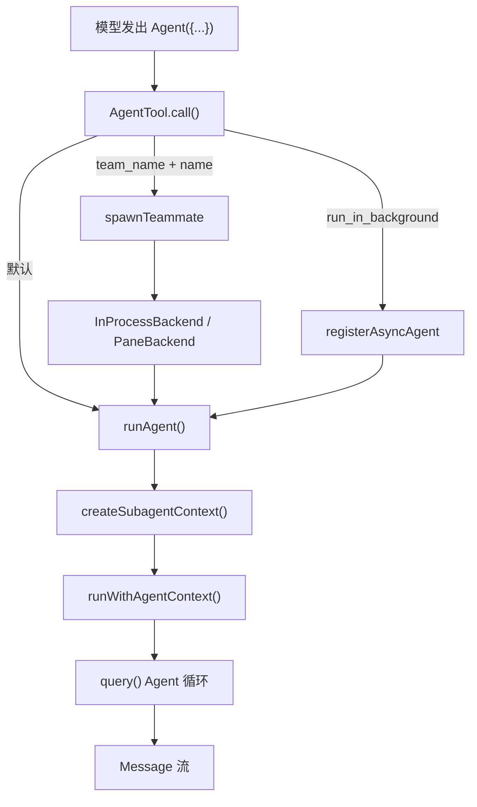

# cc-haha 代码里的 “Agent” 到底是什么

> 代码基线：`main` @ `569bf22`
> 结论：仓库里**没有**一个叫 `Agent` 的类。`Agent` 在不同层分别是定义数据、工具对象、运行时身份、执行函数和上下文。

---

## 0. 一张表先分清

| 层 | 实体 | 位置 | 性质 | 有方法吗 |
|---|---|---|---|---|
| 配置/定义 | `AgentDefinition` | `src/tools/AgentTool/loadAgentsDir.ts:110-184` | 纯数据 | 只有 `getSystemPrompt()` |
| 工具 | `AgentTool` | `src/tools/AgentTool/AgentTool.tsx` | `buildTool` 生成的对象 | 有 `call()` 等 |
| 运行时身份 | `AgentContext` | `src/utils/agentContext.ts:32-91` | AsyncLocalStorage 中的值 | 无，配套函数操作 |
| 执行 | `runAgent()` | `src/tools/AgentTool/runAgent.ts:328` | async generator | — |
| 运行时上下文 | `ToolUseContext` | `src/Tool.ts:164` | 对象 | 有 `getAppState/setAppState` 等 |
| 对外协议 | `AgentInfo` | `src/entrypoints/sdk/coreSchemas.ts:1032` | 纯数据 | 无 |
| 桌面 CRUD | `AgentDefinition` + `AgentService` | `src/server/services/agentService.ts:22` | DTO + 服务 | 有 CRUD 方法 |

---

## 1. `AgentDefinition`：Agent 的配置

这是 Markdown frontmatter 或 JSON 解析出来的规格对象。它描述“一个 Agent 应该是什么样”，本身不执行任何东西。

### 公共字段（`BaseAgentDefinition`）

| 字段 | 类型 | 说明 |
|---|---|---|
| `agentType` | `string` | 名称，如 `Explore`、`general-purpose` |
| `whenToUse` | `string` | 何时使用，给主模型看 |
| `tools` / `disallowedTools` | `string[]` | 工具白名单/黑名单 |
| `skills` | `string[]` | 预加载的 skill |
| `mcpServers` | `AgentMcpServerSpec[]` | 该 Agent 专属 MCP |
| `hooks` | `HooksSettings` | 启动时注册的 hook |
| `color` | `AgentColorName` | UI 标识色 |
| `model` | `string` | `opus/sonnet/haiku/fable/inherit` 或完整 ID |
| `provider` | `string` | 为这个 Agent 单独指定供应商 |
| `effort` | `EffortValue` | `low / medium / high / xhigh / max` |
| `permissionMode` | `PermissionMode` | `default/plan/acceptEdits/...` |
| `maxTurns` | `number` | 最大轮数 |
| `background` | `boolean` | 默认后台运行 |
| `initialPrompt` | `string` | 第一轮前追加的内容 |
| `memory` | `user/project/local` | 记忆作用域 |
| `isolation` | `worktree/remote` | 隔离方式 |
| `omitClaudeMd` | `boolean` | 不注入 CLAUDE.md |
| `rawSystemPrompt` | `string?` | 运行时扩展前的原始提示词 |
| `rawTools` | `string[]?` | 运行时扩展前的工具列表 |
| `sourceFilePath` | `string?` | Markdown 来源路径 |
| `sourceContentHash` | `string?` | 来源内容哈希 |
| `criticalSystemReminder_EXPERIMENTAL` | `string?` | 每轮重复注入的提醒 |
| `requiredMcpServers` | `string[]?` | 必须配置的 MCP |

### 三个变体

```ts
type AgentDefinition =
  | BuiltInAgentDefinition
  | CustomAgentDefinition
  | PluginAgentDefinition
```

| 变体 | `source` | 特有字段 |
|---|---|---|
| `BuiltInAgentDefinition` | `'built-in'` | `getSystemPrompt(params)`、`callback?` |
| `CustomAgentDefinition` | `user/project/local/...` | `rawSystemPrompt`、`getSystemPrompt()` |
| `PluginAgentDefinition` | `'plugin'` | `plugin: string`、`getSystemPrompt()` |

类型守卫：

```ts
isBuiltInAgent(agent)
isCustomAgent(agent)
isPluginAgent(agent)
```

内置定义只有 6 个：`general-purpose`、`Explore`、`Plan`、`verification`、`claude-code-guide`、`statusline-setup`（`src/tools/AgentTool/builtInAgents.ts:67-89`）。

---

## 2. `AgentTool`：模型调用的那个工具

模型写 `Agent({...})` 时进入的就是它。定义在 `src/tools/AgentTool/AgentTool.tsx`，由 `buildTool` 生成。

### 属性

| 属性 | 值 |
|---|---|
| `name` | `AGENT_TOOL_NAME` |
| `aliases` | `[LEGACY_AGENT_TOOL_NAME]` |
| `searchHint` | `'delegate work to a subagent'` |
| `maxResultSizeChars` | `100_000` |
| `inputSchema` | 见下 |
| `outputSchema` | 同步 `completed` / 异步 `async_launched` |

### 输入

```ts
{
  description: string          // 3-5 词任务简述
  prompt: string               // 任务内容
  subagent_type?: string       // Explore / Plan / general-purpose / 自定义
  model?: 'fable'|'sonnet'|'opus'|'haiku'
  run_in_background?: boolean
  name?: string                // 可被 SendMessage 寻址
  team_name?: string           // 加入团队
  mode?: PermissionMode        // 成员的权限模式
  isolation?: 'worktree'|'remote'
  cwd?: string
}
```

### 方法

```ts
call(input, toolUseContext, canUseTool, assistantMessage, onProgress?): Promise<Output>

description(): Promise<string>       // "Launch a new agent"
prompt(): Promise<string>
isEnabled(): boolean
validateInput(input)
mapToolResultToToolResultBlockParam(...)
renderToolUseMessage(...)
renderToolResultMessage(...)
```

`call()` 内部会根据参数走三条路径：

```text
team_name + name  → spawnTeammate（Teams）
run_in_background → 注册异步任务
否则              → 同步 runAgent()
```

---

## 3. `AgentContext`：运行时的身份

位置：`src/utils/agentContext.ts:32-91`。它不包含业务状态，只用于归因、日志和隔离。

```ts
type SubagentContext = {
  agentId: string
  parentSessionId?: string
  agentType: 'subagent'
  subagentName?: string
  isBuiltIn?: boolean
  invokingRequestId?: string
  invocationKind?: 'spawn' | 'resume'
  invocationEmitted?: boolean
}

type TeammateAgentContext = {
  agentId: string
  agentName: string
  teamName: string
  agentColor?: string
  planModeRequired: boolean
  parentSessionId: string
  isTeamLead: boolean
  agentType: 'teammate'
  invokingRequestId?: string
  invocationKind?: 'spawn' | 'resume'
  invocationEmitted?: boolean
}

type AgentContext = SubagentContext | TeammateAgentContext
```

配套函数：

```ts
getAgentContext()
runWithAgentContext(context, fn)
isSubagentContext(ctx)
isTeammateAgentContext(ctx)
getSubagentLogName()
consumeInvokingRequestId()
```

为什么用 `AsyncLocalStorage`：多个后台 Agent 可能在同一进程并发运行，共享的 `AppState` 会互相覆盖，而 `AsyncLocalStorage` 能把每个异步调用链隔离开。

---

## 4. `runAgent()`：真正执行 Agent 的函数

位置：`src/tools/AgentTool/runAgent.ts:328`，是一个 async generator。

```ts
export async function* runAgent({
  agentDefinition,
  promptMessages,
  toolUseContext,
  canUseTool,
  isAsync,
  isBackgrounded,
  canShowPermissionPrompts,
  forkContextMessages,
  querySource,
  override: { abortController?, agentId?, systemPrompt?, ... },
  model,
  maxTurns,
  availableTools,
  allowedTools,
  worktreePath,
  description,
  spawningToolUseId,
  ownerAgentId,
  recordedUuids,
  extraMetadata,
  workflow,
  onQueryProgress,
  ...
}): AsyncGenerator<Message, void>
```

它内部调用 `query()` 跑 Agent 循环。**不存在 `agent.run()` 这种实例方法**——执行是“函数 + 参数”的形式。

---

## 5. `ToolUseContext`：最接近“Agent 实例”的东西

位置：`src/Tool.ts:164`。每个 Agent 通过 `createSubagentContext(parentContext, overrides)` 得到一份隔离的上下文。

```ts
type ToolUseContext = {
  options: {
    commands: Command[]
    debug: boolean
    mainLoopModel: string
    tools: Tools
    verbose: boolean
    thinkingConfig: ThinkingConfig
    mcpClients: MCPServerConnection[]
    mcpResources: Record<string, ServerResource[]>
    isNonInteractiveSession: boolean
    agentDefinitions: AgentDefinitionsResult
    maxBudgetUsd?: number
    customSystemPrompt?: string
    appendSystemPrompt?: string
    querySource?: QuerySource
    refreshTools?: () => Tools
  }
  abortController: AbortController
  readFileState: FileStateCache
  getAppState(): AppState
  setAppState(fn): void
  setAppStateForTasks?: (fn) => void
  handleElicitation?(...)
  setToolJSX?(...)
  addNotification?(...)
  appendSystemMessage?(...)
  sendOSNotification?(...)
  loadedNestedMemoryPaths?: Set<string>
  dynamicSkillDirTriggers?: Set<string>
  discoveredSkillNames?: Set<string>
}
```

`createSubagentContext` 的默认隔离策略：

- `readFileState` 从父上下文克隆；
- `abortController` 新建并链接到父控制器（父取消会传播）；
- `setAppState` 默认变成 no-op；
- 只有在显式 `shareSetAppState` / `shareAbortController` 时才共享。

---

## 6. `AgentInfo`：暴露给 SDK 的对外协议

位置：`src/entrypoints/sdk/coreSchemas.ts:1032`。

```ts
{
  name: string          // agentType，如 "Explore"
  description: string   // whenToUse
  model?: string        // 省略表示继承父会话
}
```

`initialize` 控制响应里的 `agents` 就是这个数组。它只暴露三个字段，内部定义的其他属性不会传给客户端。

---

## 7. 桌面端的 `AgentDefinition` 和 `AgentService`

位置：`src/server/services/agentService.ts:22`。

这是 Web API / 桌面 UI 的 DTO：

```ts
type AgentDefinition = {
  name: string
  description?: string
  model?: string
  provider?: string
  effort?: string | number
  tools?: string[]
  systemPrompt?: string
  color?: string
}
```

`AgentService` 方法：

```ts
getAgent(name, context)
createAgent(...)
updateAgent(...)
deleteAgent(...)
resolveAgentsDir(context)
```

它负责读写：

```text
~/.claude/agents/*.md          # 用户作用域
<project>/.claude/agents/*.md  # 项目作用域
```

保存后，如果桌面端连着运行中的会话，会触发热重载。

---

## 8. 运行时调用链



对应的代码路径：

```text
src/tools/AgentTool/AgentTool.tsx:257      call()
src/tools/AgentTool/runAgent.ts:328        runAgent()
src/utils/forkedAgent.ts:364              createSubagentContext()
src/utils/agentContext.ts:108             runWithAgentContext()
src/query.ts:250                          queryLoop()
```

---

## 9. 和官方 Agent SDK 的边界

官方 SDK 与 cc-haha 的关系是**进程边界**，不是类继承：

```text
官方 SDK（客户端）  --  initialize / control_request / stream-json  -->  CLI 子进程（Agent 运行时）
cc-haha 桌面端       --  同一套 /sdk 协议                          -->  cc-haha CLI
```

- `AgentInfo` 是协议里暴露 Agent 元数据的结构。
- 真正的 Agent 定义、工具池、权限、循环都在 CLI 进程内部。
- cc-haha 的 `agentSdkTypes.ts` 里 `query()` / `tool()` / `createSdkMcpServer()` 都是 `throw new Error('not implemented')`，说明它只有 CLI 侧类型，不是 SDK 客户端。

---

## 10. 快速回答

如果只想要一句话：

> 代码里没有 `Agent` 类。**定义**是 `AgentDefinition`（数据），**工具**是 `AgentTool`（有 `call()`），**身份**是 `AgentContext`（AsyncLocalStorage），**执行**是 `runAgent()`（async generator），**运行时状态**是 `ToolUseContext`，**对外协议**是 `AgentInfo`。

在 Markdown 里定义一个 Agent 时，你写的 frontmatter 最终会变成 `AgentDefinition`；模型调用 `Agent({...})` 时，`AgentTool.call()` 解析它，然后交给 `runAgent()` 执行。
