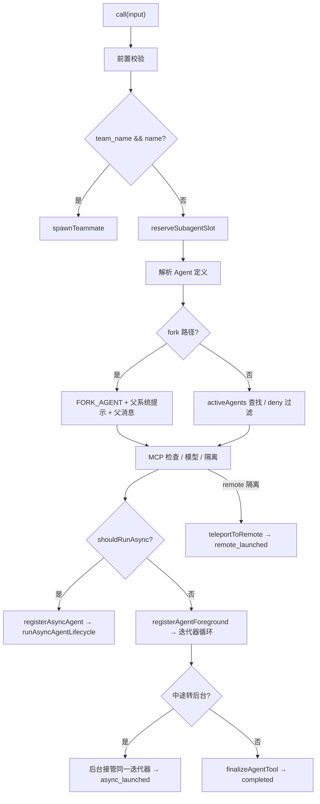

# `AgentTool.call()` 的实现拆解

> 代码基线：`main` @ `569bf22`
> 位置：`src/tools/AgentTool/AgentTool.tsx:255-1345`（约 1090 行）
> 上游：`runAgent()`（`src/tools/AgentTool/runAgent.ts:328`）→ `query()`（`src/query.ts:250`）

---

## 0. 总览

`AgentTool` 由 `buildTool` 生成，`call()` 是它的执行方法。一次调用可能进入 **七条路径**：



---

## 1. 入口签名（255-266）

```ts
async call(
  {
    prompt,
    subagent_type,
    description,
    model: modelParam,
    run_in_background,
    name,
    team_name,
    mode: spawnMode,
    isolation,
    cwd,
  }: AgentToolInput,
  toolUseContext,
  canUseTool,
  assistantMessage,
  onProgress?,
)
```

---

## 2. 前置校验（267-300）

| 检查 | 位置 | 行为 |
|---|---|---|
| coordinator 模式忽略 `model` | 268 | 统一用 coordinator 模型 |
| lean 模式限制 | 272-275 | 不允许 team / mode / isolation / cwd |
| 未开通 Teams 却传 `team_name` | 282-284 | 抛错 |
| teammate 再 spawn teammate | 292-294 | 拒绝，roster 是扁平的 |
| in-process teammate 开后台 Agent | 298-300 | 拒绝，生命周期绑在 leader 进程 |

`teamName` 不只来自参数，还会从当前上下文解析：

```ts
const teamName = lean ? undefined : resolveTeamName({ team_name }, appState)
```

---

## 3. 分支 A：Teams spawn（304-337）

触发条件：`teamName && name`。

```ts
const result = await spawnTeammate({
  name,
  prompt,
  description,
  team_name: teamName,
  use_splitpane: true,
  plan_mode_required: spawnMode === 'plan',
  model,
  agent_type: subagent_type,
  invokingRequestId: assistantMessage?.requestId,
}, toolUseContext)
```

返回：

```ts
{
  status: result.data.staged ? 'teammate_staged' : 'teammate_spawned',
  prompt,
  ...result.data,
}
```

**不会进入 `runAgent`**。真正的成员执行由 `spawnTeammate` → Backend → `startInProcessTeammate` 负责。

---

## 4. 名额预留（341-347）

```ts
const releaseSubagentSlot = reserveSubagentSlot()
let slotTransferred = false
using _subagentSlot = {
  [Symbol.dispose]: () => {
    if (!slotTransferred) releaseSubagentSlot()
  },
}
```

`reserveSubagentSlot()`（`src/tools/AgentTool/subagentConcurrency.ts:7`）：

- 读取 `getMaxConcurrentSubagentsUncached()`；
- 超过上限**直接抛错，不排队**，避免嵌套子 Agent 等父 Agent 释放名额而死锁；
- 检查与自增之间没有 `await`，保证原子性。

异步路径会把释放责任交给后台生命周期（`slotTransferred = true`）。

---

## 5. 解析 Agent 定义（348-386）

```ts
const effectiveType =
  subagent_type ??
  (!lean && isForkSubagentEnabled() ? undefined : 'general-purpose')

const isForkPath = effectiveType === undefined
```

三种情况：

| 输入 | 结果 |
|---|---|
| 显式 `subagent_type` | 普通 Agent |
| 没给 type 且 fork gate 开 | `FORK_AGENT` |
| 没给 type 且 gate 关 | 默认 `general-purpose` |

fork 路径有递归保护（362-364）：

```ts
if (
  querySource === `agent:builtin:${FORK_AGENT.agentType}` ||
  isInForkChild(messages)
) {
  throw new Error('Fork is not available inside a forked worker...')
}
```

普通路径在 `activeAgents` 里查找，同时应用：

- `allowedAgentTypes`（来自 `Agent(x,y)` 工具规范）；
- `filterDeniedAgents`（权限规则里的 deny）；
- 找不到时分两种报错：被 deny 规则拒绝 / 类型不存在。

---

## 6. 等待必需 MCP（397-440）

如果定义里有 `requiredMcpServers`：

- 每 500ms 轮询，最多等 30 秒；
- 任一 required server 进入 `failed` 就提前退出；
- 通过 `mcp__server__tool` 前缀统计“真的有工具的 server”；
- 缺失就抛错，提示去 `/mcp` 配置。

---

## 7. 模型与隔离（447-518, 634-639）

模型解析：

```ts
selectedAgent.provider
  ? resolveAgentProviderRoute({ agentType, providerId, model }).model
  : getAgentModel(
      getAgentModelSetting(selectedAgent, mainLoopModel),
      mainLoopModel,
      isForkPath ? undefined : modelParam,
      permissionMode,
    )
```

隔离：

| 模式 | 行为 |
|---|---|
| `remote`（仅 ant） | `teleportToRemote` → 注册 `remote-agent` 任务 → 返回 `remote_launched` |
| `worktree` | `createAgentWorktreeIfSupported('agent-<id前8位>')` |
| 创建失败 | **不报错**，降级到工作目录，结果里带 `worktreeIsolationSkipped` |

---

## 8. 构造系统提示与消息（528-579）

### fork 路径

```ts
forkParentSystemPrompt =
  toolUseContext.renderedSystemPrompt ?? 重新构建父系统提示

promptMessages = buildForkedMessages(prompt, assistantMessage)
```

目的是让子 Agent 的 API 请求前缀与父 Agent **逐字节一致**，命中 prompt cache。因此还会：

```ts
useExactTools: true
forkContextMessages: toolUseContext.messages
availableTools: toolUseContext.options.tools
```

### 普通路径

```ts
const agentPrompt = selectedAgent.getSystemPrompt({ toolUseContext })
enhancedSystemPrompt = await enhanceSystemPromptWithEnvDetails(
  [agentPrompt],
  resolvedAgentModel,
  additionalWorkingDirectories,
)
promptMessages = [createUserMessage({ content: prompt })]
```

注意：`getSystemPrompt` 抛错会被吞掉，只记日志（571-573），然后继续执行。

---

## 9. 同步还是异步（589-615）

```ts
const forceAsync = isForkSubagentEnabled()
const assistantForceAsync = appState.kairosEnabled

const shouldRunAsync =
  (run_in_background === true ||
   selectedAgent.background === true ||
   isCoordinator ||
   forceAsync ||
   assistantForceAsync ||
   proactiveActive) &&
  !isBackgroundTasksDisabled
```

worker 工具池：

```ts
const workerPermissionContext = {
  ...appState.toolPermissionContext,
  mode: selectedAgent.permissionMode ?? 'acceptEdits',
}
const workerTools = assembleToolPool(workerPermissionContext, appState.mcp.tools)
```

**关键**：子 Agent 的工具池按自己的权限模式重新组装，不复用父 Agent 的限制；默认 `acceptEdits`。

---

## 10. 分支 B：异步执行（749-828）

```ts
const agentBackgroundTask = registerAsyncAgent({
  agentId,
  description,
  prompt,
  selectedAgent,
  setAppState: rootSetAppState,
  toolUseId,
  ownerAgentId,
})

registerAgentName(agentId)  // 让 SendMessage 能按 name 找到

void runWithAgentContext(asyncAgentContext, () =>
  wrapWithCwd(() =>
    runAsyncAgentLifecycle({
      taskId: agentBackgroundTask.agentId,
      abortController: agentBackgroundTask.abortController,
      makeStream: onCacheSafeParams =>
        runAgent({
          ...runAgentParams,
          override: { ...runAgentParams.override, agentId, abortController },
          onCacheSafeParams,
        }),
      ...
    }),
  ),
)

return { data: { status: 'async_launched', agentId, outputFile, ... } }
```

特点：

- 后台 Agent **不链接父 abortController**，父会话按 Esc 不会杀掉它；
- 立即返回 `async_launched`；
- 完成后通过 `<task-notification>` 回来。

---

## 11. 分支 C：同步执行（829-1343）

### 11.1 注册前台任务

```ts
const registration = registerAgentForeground({
  agentId: syncAgentId,
  description,
  prompt,
  selectedAgent,
  autoBackgroundMs: getAutoBackgroundMs() || undefined,
  ...
})
backgroundPromise = registration.backgroundSignal.then(() => ({ type: 'background' }))
```

虽然当前同步执行，但任务已注册，因此可以随时转后台。

### 11.2 abort 关系

```ts
const agentAbortController = isLocalAgentTask(foregroundTask)
  ? foregroundTask.abortController
  : createAbortController()

const abortFromParent = () => {
  if (!isBackgrounded()) {
    agentAbortController.abort(toolUseContext.abortController.signal.reason)
  }
}
toolUseContext.abortController.signal.addEventListener('abort', abortFromParent, { once: true })
```

即：**没转后台时跟随父取消；转后台后解除监听**。

### 11.3 迭代器

```ts
const agentIterator = runAgent({
  ...runAgentParams,
  override: { agentId: syncAgentId, abortController: agentAbortController },
  isBackgrounded,
  onCacheSafeParams,
})[Symbol.asyncIterator]()
```

### 11.4 主循环：消息与后台信号竞速

```ts
const raceResult = await Promise.race([
  agentIterator.next().then(r => ({ type: 'message', result: r })),
  backgroundPromise,
])
```

三种结果：

| 结果 | 行为 |
|---|---|
| 普通消息 | 记录、统计 token/tool 数、转发 progress |
| `done` | 退出循环 |
| `background` | 把在途的 `nextMessagePromise` 交给后台协程继续消费，父 Agent 立即返回 `async_launched` |

### 11.5 后台接管（981-1127）

```ts
let result = await nextMessagePromise
while (!result.done) {
  agentMessages.push(result.value)
  updateAsyncAgentProgress(...)
  emitAgentToolActivitiesForMessage(...)
  result = await agentIterator.next()
}
const agentResult = finalizeAgentTool(agentMessages, backgroundedTaskId, metadata)

completeAsyncAgent(agentResult, rootSetAppState)
enqueueAgentNotification({ status: 'completed', ... })
```

刻意复用同一个 in-flight 的 `next()`，避免丢消息或重复执行工具。

### 11.6 finally 清理

- 移除 UI 提示；
- 注销前台任务；
- 停止摘要器；
- 清理 skill 作用域和 dumpState；
- 取消自动转后台定时器；
- 处理 worktree：
  - 无改动 → 删除；
  - 有改动 → 保留，并把路径写进 metadata。

### 11.7 结果收敛

```ts
const agentResult = finalizeAgentTool(agentMessages, syncAgentId, metadata)
```

`finalizeAgentTool`（`src/tools/AgentTool/agentToolUtils.ts:278`）：

1. 取最后一条 assistant 消息；
2. 如果没有文本，向前找最近一条有文本的 assistant；
3. 统计 token 与 tool use 次数；
4. 返回 `content / totalToolUseCount / totalDurationMs`。

如果启用 `TRANSCRIPT_CLASSIFIER`，还会跑 `classifyHandoffIfNeeded`，必要时在结果前插入提醒。

最终返回：

```ts
{ status: 'completed', prompt, ...agentResult, ...worktreeResult }
```

---

## 12. 结果如何回到模型（1380+）

`mapToolResultToToolResultBlockParam` 把 `data` 转成文本：

| status | 返回给模型的内容 |
|---|---|
| `teammate_spawned` | `Spawned successfully. agent_id / name / team_name ...` |
| `remote_launched` | `Remote agent launched in CCR. taskId / session_url / output_file ...` |
| `async_launched` | `Async agent launched successfully. agentId ... will be notified` + 操作指引 |
| `completed` | 子 Agent 最后的文本内容 |

`async_launched` 的文本还会根据 `canReadOutputFile` 给出不同指引：能读文件就告诉模型可以用 Read/Bash tail 查进度，不能读就要求它简短汇报并结束回复。

---

## 13. 工具级属性

```ts
isReadOnly() {
  return true // delegates permission checks to its underlying tools
}

isConcurrencySafe() {
  return true
}

async checkPermissions(input, context) {
  if (ant && mode === 'auto') return { behavior: 'passthrough' }
  return { behavior: 'allow', updatedInput: input }
}
```

含义：

- Agent 工具本身不改文件，修改发生在子 Agent 的工具里；
- 同一批里可以并发 spawn 多个子 Agent，并发上限由 `reserveSubagentSlot` 控制；
- 外部构建下 Agent spawn 基本自动放行。

---

## 14. 关键设计点

1. **fork 路径为了 prompt cache 牺牲独立性**：继承父系统提示、父工具数组、父消息历史，只加一条 fork 指令。
2. **worktree 是“尽力而为”**：没有 git 仓库或没有 WorktreeCreate hook 时降级到工作目录，不阻塞 spawn。
3. **同步转后台是同一迭代器的交接**：不是重新跑一遍，而是把已有的 `next()` Promise 交给后台协程。
4. **子 Agent 工具池独立组装**：按自己的 `permissionMode` 重新 `assembleToolPool`，不受父工具限制影响。
5. **名额不排队**：超过并发上限直接报错，避免嵌套死锁。

---

## 15. 复杂度问题

- `call()` 单函数 1090 行，包含 Teams / remote / fork / worktree / sync / async / sync→async 七种路径；
- 同步路径里再嵌一个后台协程，状态变量有 `wasBackgrounded / slotTransferred / worktreeResult / syncAgentError / wasAborted` 等；
- 系统提示构建失败被静默吞掉；
- worktree 清理与通知顺序依赖注释约束，缺少类型层面的保证。

如果要重构，比较安全的切入点：

1. 按 `isForkPath / shouldRunAsync` 拆成独立的执行策略；
2. 把 Teams 和 remote 分支移出 `call()`；
3. 把 sync → async 的交接抽成显式的 `AgentExecution` 对象，而不是散落的布尔变量。
