# cc-haha 内核实现深度分析

> 分析对象：`zhangjunyi111/cc-haha`（上游 `NanmiCoder/cc-haha`）
> 代码基线：`main` @ `569bf22`
> 分析范围：`src/`（CLI 内核）、`desktop/sidecars/`、`src/server/ws/` 的桥接层
> 说明：本文只做技术分析，不含法律意见；引用格式为 `file:line`。

---

## 结论摘要

1. **内核确实是 Claude Code 的内部实现**，但不是完整版本。它是一个“外部化构建”：通过 `feature()` 编译期门控、`USER_TYPE === 'ant'` 分支和 **164 个自动生成的 Proxy 占位模块**，把 Anthropic 内部专属功能裁掉。外部构建能跑的部分是真的，被裁掉的部分并不等于“不可用”，而是静默地不存在。
2. **Agent 主循环是单生成器状态机**（`query.ts`，1782 行），流式解析集中在 `services/api/claude.ts`。设计成熟，但存在两条工具执行路径语义漂移、状态重建靠手写 `continue`、并发队列无锁等问题。
3. **工具系统契约完整**（zod 校验、并发安全标记、结果落盘、权限钩子），但默认 `checkPermissions = allow`、MCP 参数零校验、WebFetch 不拦内网，是明确的攻击面。
4. **桌面端不是把 CLI 嵌进 UI**，而是 Electron → 本地 Server Sidecar → 每会话一个真实 CLI 子进程，通过内部 `/sdk/:sessionId` WebSocket + HTTP POST 双向通信。这条桥接是整个项目最值得看的部分。
5. **工程质量显著高于同类项目**：真实 CLI + 真实工具 + 脚本化模型的确定性端到端门禁，配 replay cassette 和 provider contract，能在无凭据、无网络的情况下守住 PR。

---

## 一、内核的由来与构建方式

### 1.1 身份证据

- 根 `package.json`：`name = claude-code-local`、`version = 999.0.0-local`、`bin.claude-haha`。
- `src/` 包含 Claude Code 的完整内部结构：`QueryEngine.ts`、`main.tsx`、`tools/`、`commands/`、`services/api/`、`utils/permissions/`、`memdir/`、`proactive/`、`coordinator/`。
- **1509 处 `tengu_*` 遥测事件名**，与官方内部命名一致。
- `src/commands.ts:56` 出现 `process.env.USER_TYPE === 'ant'` 分支，加载 `agents-platform` 内部命令。
- `src/cli/transports/HybridTransport.ts:47-52` 的注释直接提到 Firestore、CCR、`pages oncall`——这是 Anthropic 内部远程会话基础设施的实现痕迹。

### 1.2 启动包装器

`bin/claude-haha` 是一个 Bun 包装器：

- 解析仓库根目录与 `CALLER_DIR`（用户实际工作目录），随后 `chdir` 到调用目录。
- 传入 `--feature=TRANSCRIPT_CLASSIFIER`（`:23`），这是外部构建唯一启用的 feature flag。
- 用 `Bun.spawn` 启动 `src/entrypoints/cli.tsx`，继承 stdin/stdout/stderr，并把 `SIGINT`/`SIGTERM` 转发给子进程。
- 若 `CLAUDE_CODE_FORCE_RECOVERY_CLI=1`，改走 `src/localRecoveryCli.ts`。

`preload.ts`（由 `bunfig.toml` 自动加载）注入 `MACRO.VERSION`、`MACRO.PACKAGE_URL`、`MACRO.BUILD_TIME` 等编译期常量，并禁用远程预取。

### 1.3 feature 门控与占位模块

工具注册表 `src/tools.ts` 大量使用编译期条件加载：

```ts
const SleepTool = feature('PROACTIVE') || feature('KAIROS')
  ? require('./tools/SleepTool/SleepTool.js').SleepTool
  : null
const WebBrowserTool = feature('WEB_BROWSER_TOOL') ? ... : null
const ListPeersTool = feature('UDS_INBOX') ? ... : null
```

统计到的门控名包括 `KAIROS`、`TRANSCRIPT_CLASSIFIER`、`BASH_CLASSIFIER`、`TEAMMEM`、`PROACTIVE`、`VOICE_MODE`、`AGENT_TRIGGERS`、`MONITOR_TOOL`、`WEB_BROWSER_TOOL`、`UDS_INBOX`、`COORDINATOR_MODE`、`HISTORY_SNIP`、`CONTEXT_COLLAPSE` 等。

同时，`src/` 下有 **164 个文件**开头是：

```ts
// @generated stub from scan-missing-imports
// 该文件自动生成，对应 ant-internal 的 feature() gated 模块。
```

这些模块导出一个“任意属性/任意调用都返回自身”的 `Proxy`。分布在：`skills` 30、`tools` 21、`services` 19、`components` 17、`commands` 15、`utils` 14、`server` 8、`types` 7。

关键判断：

- 对**类型模块**（如 `src/types/message.ts`）无害，因为 `import type` 在编译期被擦除。
- 对**运行时模块**，只要其调用点被 `feature()` 包住，`bun build` 的 DCE 会把整条路径删掉，因此不会执行。
- 风险在于：一旦某个 feature 被开启而对应模块仍是 stub，会得到“调用成功但什么也没做”的静默失败，而不是报错。这是重构版与官方内部版之间最难审计的差异。

### 1.4 由此得出的结论

这是一个**可运行的外部子集**，不是完整的 Claude Code：

- 核心循环、工具、权限、Provider、MCP、会话持久化是真实现。
- REPL 工具、Snip、WebBrowser 工具、终端面板、内部遥测、ant 专属命令等是门控/占位。
- 文档里宣传的部分能力（如某些内置工具）可能依赖桌面端自己实现，而不是内核工具。

---

## 二、启动与进程模型

### 2.1 CLI 路径

```text
bin/claude-haha
  → bun --feature=TRANSCRIPT_CLASSIFIER src/entrypoints/cli.tsx
  → src/main.tsx:591
  → setup()（src/setup.ts:56）
  → launchRepl（src/main.tsx:3231）
  → src/replLauncher.tsx:12
  → src/screens/REPL.tsx:3500（提交入口）
```

### 2.2 桌面路径

```text
Electron main（desktop/electron/main.ts）
  → 启动 claude-sidecar server（desktop/sidecars/claude-sidecar.ts）
  → Bun.serve（src/server/index.ts）
  → 每个会话按需 spawn CLI 子进程
  → CLI 通过 --sdk-url 连接 /sdk/:sessionId
```

`src/server/services/conversationService.ts` 负责构造子进程环境，关键变量：

- `CLAUDE_CODE_ENTRYPOINT=claude-desktop`（`:2622-2628`），让 CLI 忽略外部残留的 `ANTHROPIC_*` 环境。
- `CLAUDE_CODE_ENABLE_SDK_FILE_CHECKPOINTING=1`（`:2487`）。
- `CLAUDE_CODE_EMIT_SESSION_STATE_EVENTS=1`（`:2547`）。
- 官方账号模式下注入 `CLAUDE_CODE_OAUTH_TOKEN`、`CLAUDE_CODE_ACCOUNT_UUID`（`:2637-2639`）。

**关键设计**：Renderer 不是会话状态的唯一真相源。Server 持有会话、Provider、权限模式、运行状态；CLI 负责模型请求与工具执行；Renderer 只是客户端。这条边界在 `docs/internals/desktop.md` 和实际代码中是一致的。

---

## 三、Agent 主循环

### 3.1 一条用户消息的完整调用链

```text
REPL.tsx:3500 提交
  → handlePromptSubmit.ts:120（:560 调 onQuery）
  → REPL.tsx:2865
  → QueryGuard.tryStart（QueryGuard.ts:61）
  → onQueryImpl（REPL.tsx:2666）
  → query()（REPL.tsx:2799）
  → query.ts:228 → queryLoop:250
```

`queryLoop` 每一轮的顺序：

1. **预算与压缩检查**（`query.ts:391,415,426,453,466`）。
2. **调用模型**：`deps.callModel`（`:697`）→ `services/api/claude.ts:860`，流式消费。
3. **执行工具**：批量路径 `runTools:1425`，流式路径 `addTool:884`。
4. **附件与队列**：`:1629`。
5. **状态推进**：`state = next`（`:1768`），回到 while。

无工具调用时，执行 stop hooks（`:1310`）后返回。

SDK 路径独立：`QueryEngine.ts:233 submitMessage` → `:802 query`，再映射为 SDKMessage。

### 3.2 流式解析与分发

集中在 `services/api/claude.ts:2412-2769`：

- `text_delta`（`:2553`）、`thinking_delta`（`:2588`）、`input_json_delta`（`:2524`）分别累加进 `contentBlocks`。
- `content_block_stop`（`:2641`）生成完整的 `AssistantMessage`，经 `assistantCommitBuffer`（`:2659`）yield。
- `message_delta`（`:2707`）原地写 usage / stop_reason，并为 transcript 保留 100ms 惰性序列化窗口。
- 另发 `stream_event`（`:2771`）供需要增量渲染的客户端使用。

分发到 TUI：`utils/messages.ts:3213`。文本走 `onStreamingText:3342`，工具参数增量进 `streamingToolUses:3348`，thinking 只计数（`:3367`），完成块才展示（`:3247`）。完整消息在 `REPL.tsx:2634` 写入消息列表。

只有 `includePartialMessages` 为真时，`QueryEngine.ts:916-953` 才向 SDK 客户端转发 `stream_event`。

### 3.3 工具并发模型

`utils/toolOrchestration.ts:91` 按 `Tool.isConcurrencySafe` 分批：

- **连续的安全调用**并发执行，上限 `CLAUDE_CODE_MAX_TOOL_USE_CONCURRENCY`，默认 10（`:8,175`）。
- **非安全工具**独占串行（`:65,118`）。

流式路径由 `StreamingToolExecutor` 实现：`addTool:76` 边收边跑，`canExecuteTool:129` 保证非安全工具独占，`processQueue:140` 保持顺序。

**问题**：流式路径没有 10 的并发上限；两条路径的语义并不完全一致。

### 3.4 错误、重试与降级

`services/api/withRetry.ts:415` 是统一重试层，默认 10 次（`:60`）：

- **429**：尊重 `Retry-After`（`:684`）。
- **529**：连续 3 次触发 `FallbackTriggeredError`（`:588`），`query.ts:936` 丢弃已产消息并切换 fallback model。
- **上下文溢出**：先调小 `max_tokens`（`:644`）。
- **prompt too long**：先暂扣（`query.ts:841`）→ collapse drain（`:1128`）→ reactive compact（`:1163`）→ 仍失败才上抛（`:1216`）。
- **max_output_tokens**：升到 64k 并最多续写 3 次（`:1231`）。
- **流中断**：watchdog（`claude.ts:2157`）→ 非流式兜底（`:2790`）；可重放错误转 `RetriableStreamError:3119` 重开流；否则 flush 部分内容后抛错（`:3033`）。
- 最终错误转成 assistant 消息（`:3472`）；外层 catch 补发缺失的 `tool_result`（`query.ts:997`）。

### 3.5 中断传播

- Esc → `REPL.tsx:2108 onCancel` → `queryGuard.forceEnd:2120` → `abort('user-cancel'):2154`。
- 新消息打断使用 `'interrupt'`（`:4112`）；`query.ts:1089` 据此抑制中断消息。
- `query.ts:1058/1534` 检查 signal：流式路径由 `getAbortReason:210` 生成合成 `tool_result`；批量路径由 `yieldMissingToolResultBlocks:132` 补齐。
- `StreamingToolExecutor` 有 sibling controller（`:59`）和每工具子 controller（`:301`），取消向上冒泡（`:304`）。
- `interruptBehavior='block'` 的工具不会被取消（`:219`）。
- `claude.ts:2967` 保留部分文本并抛 `APIUserAbortError`；`:3480` 释放流资源。
- 服务端 `stop_generation`（`ws/handler.ts:1010 → 2690`）发送 interrupt 并回收后台任务。

### 3.6 自动压缩

- 每轮请求前调用 `autoCompactIfNeeded`（`query.ts:466`）。
- 阈值 = 有效窗口 − min(13K, 窗口/3)（`services/compact/autoCompact.ts:147`）；估算 token 超阈值触发（`:262`）。
- 先尝试 session memory（`:416`），再走 `compactConversation:442`。
- 连续 3 次失败（`:371`）或快速回填（`:394`，`query.ts:554`）触发熔断。
- 成功后 `buildPostCompactMessages` 全量 yield（`query.ts:546`），重置 tracking（`:538`），下一轮只取 boundary 之后的消息（`:377`）。
- `QueryEngine.ts:1087` 对两个消息数组做 splice；`REPL.tsx:2591` 用 boundary 重建 UI。

### 3.7 主循环的实现问题

1. **单生成器过长**：`query.ts` 1782 行，约 7 处 `continue` 手工重建 State（`:1195,1250,1274,1326,1364,1768`），漏字段风险高。
2. **两条工具路径语义漂移**：并发上限只在批量路径；流式 Executor 无上限；Bash 的 sibling abort 只在流式路径存在。
3. **队列无锁**：`processQueue` 被 `addTool:123` 与 `finally:402` 并发调用，仅靠 status 幂等，存在启动/取消竞态。
4. **消息双写**：`QueryEngine` 同时维护 `mutableMessages` 与局部 `messages`，compact 时双 splice（`:1087`）；fire-and-forget transcript（`:855`）依赖对象原地变异（`claude.ts:2691`），非常脆弱。
5. **中止竞态**：Esc 在生成器 unwind 前清空 controller（`REPL.tsx:2161`），靠 generation 号防止 stale finally。
6. **流式→非流式兜底可能重复执行工具**：`claude.ts:2978` 的注释承认了这一点，说明重试边界与提交边界没有完全收拢。

---

## 四、工具系统

### 4.1 Tool 契约

定义在 `src/Tool.ts:379-712`，核心成员：

| 成员 | 位置 | 说明 |
|---|---|---|
| `call()` | `:396` | 实际执行 |
| `description()` | `:403` | 动态描述 |
| `inputSchema` | `:411` | zod v4 |
| `inputJSONSchema` | `:414` | MCP 原生 JSON Schema |
| `outputSchema` | `:417` | 输出约束 |
| `isConcurrencySafe` | `:419` | 并发安全标记 |
| `isEnabled` | `:420` | 运行时开关 |
| `isReadOnly` / `isDestructive` | `:421/423` | 只读/破坏性标记 |
| `maxResultSizeChars` | `:483` | 结果预算 |
| `validateInput` | `:506` | 二次校验 |
| `checkPermissions` | `:517` | 工具级权限判定 |
| `mapToolResultToToolResultBlockParam` | `:574` | 转 API block |
| `renderToolResultMessage` / `renderToolUseMessage` | `:583/622` | UI 渲染 |

`buildTool`（`:800`）的默认值（`:774-786`）值得注意：

- `isConcurrencySafe` / `isReadOnly` 默认 **false**（失败安全）。
- `checkPermissions` 默认 **allow**（失败开放）。
- `contextModifier` 仅在非并发安全工具上生效（`:346`）。

### 4.2 注册与查找

- `getAllBaseTools`（`src/tools.ts:206`）是静态数组，靠 `feature()` / env / `require()` 门控。
- `getTools`（`:289`）过滤 deny 规则（`:280`）、`isEnabled`、agentProfile。
- REPL 模式会隐藏 8 个原语工具（`:337-346`）。
- `assembleToolPool`（`:368`）合并内置工具与 MCP 工具，按名去重，内置优先。
- `findToolByName`（`:375`）线性扫描 name / aliases。
- MCP 不是独立工具类，而是在 `services/mcp/client.ts:1996-2045` 展开 `MCPTool` 模板。
- 延迟加载工具靠 `shouldDefer:459` + `ToolSearch`。
- 插件只贡献 agent，不贡献工具。

### 4.3 输入校验与错误

- zod v4，`services/tools/toolExecution.ts:636` `safeParse`。
- 失败返回 `<tool_use_error>InputValidationError`（`:685-700`），模型可见。
- `validateInput` 在 `:704-754`。
- `call()` 抛错（`:1610`）同样转成 `tool_result`，并触发 `PostToolUseFailure`。
- 权限路径会二次 parse（`utils/permissions/permissions.ts:1153`）。
- MCP 参数是 passthrough（`tools/MCPTool/MCPTool.ts:14`），客户端不校验。

### 4.4 结果截断与持久化

- 超过 `maxResultSizeChars`（`Tool.ts:483`）时，`utils/toolResultStorage.ts:272-334` 把完整结果写到会话的 `tool-results` 目录（`:114`），只回一个 `<persisted-output>` 预览（`:30,339`）。
- 图片跳过落盘（`:301`）。
- `FileReadTool` 的 `maxResultSizeChars = Infinity`（`FileReadTool.ts:345`），靠自身的 25k tokens / 256KB 限制。
- 图片转 base64 image block（`FileReadTool.ts:660-680`）；PDF 走 `DocumentBlockParam`（`:1028`）；Bash 的 data-URI 图片会压缩（`BashTool/utils.ts:96-130`）。

### 4.5 文件编辑

- `FileEditTool` 用 `strictObject`（`FileEditTool/types.ts:8-20`）。
- 编辑前检查已读状态与 mtime/内容冲突（`FileEditTool.ts:276-306`；Write 在 `:226-247`）。
- `findActualString`（`utils.ts:31-130`）会归一弯引号、缩进、换行差异。
- 多处匹配必须显式 `replace_all`（`:333-338`）。
- 写后更新 `readFileState`，并通知 LSP/VSCode（`:523-529`）。
- diff 由 `structuredPatch` 生成（`types.ts:70-90`），`UI.tsx:77` 渲染。

### 4.6 Bash 工具

- schema 在 `BashTool.ts:227-260`。
- 并发安全判定是只读命令白名单启发式（`:434-442`）。
- 超时在 `Shell.ts:197` + `wrapSpawn`（`ShellCommand.ts:403`），按进程树杀（`:318-338`）。
- 流式异步生成器，progress 在 `:663-684`；TaskOutput 支持文件/管道（`:283-288`）。
- 后台任务 `spawnShellTask:903-922`，15 秒后自动转后台（`:56`）。
- 大输出写文件并回链接（`:760-790`）。

### 4.7 权限钩子接入

- `PreToolUse` 在权限判定之前执行（`toolExecution.ts:821`），`resolveHookPermissionDecision:942`。
- 工具自己的 `checkPermissions` 由 `permissions.ts:1152-1154` 调用；deny 在 `:1211`，ask 在 `:1224`，分类器在 `:552+`。
- `canUseTool` 在 `hooks/useCanUseTool.tsx:20`。
- `PostToolUse` 在 `:1418`，失败路径在 `:1721`。

### 4.8 特殊工具

- **WorkflowTool**：用 `node:vm` 执行模型生成的编排脚本，禁用 `eval`（`utils/workflows/runtime.ts:177-184`），按 name 授权（`WorkflowTool.ts:122-186`），子 agent 禁止递归（`constants/tools.ts:36-46`）。
- **REPLTool / SnipTool**：在此构建中是自动生成的 Proxy stub（`REPLTool.ts:1-25`）。
- **TungstenTool**：禁用且 `maxResultSizeChars=0`（`TungstenTool.ts:5-39`）。
- **TestingPermission**：仅 `NODE_ENV=test`。

### 4.9 工具系统的风险

1. **默认 `checkPermissions = allow`**：新工具漏写权限逻辑就自动放行。
2. **MCP 参数零校验**：上游 schema 直接 passthrough，模型可以传任意结构。
3. **WebFetch 不拦 localhost/私网**（`WebFetchTool/utils.ts:389-396`），preapproved 域名直接 allow（`WebFetchTool.ts:105`），构成 SSRF 面。
4. **图片完全跳过结果预算**（`toolResultStorage.ts:301`），可能撑爆上下文。
5. **Bash 合并 stderr/stdout**，丢失流语义，影响模型对错误的判断。
6. **注册表是巨型静态数组 + require 循环**（`tools.ts:67-81,139-145`），增加和裁剪工具都容易出错。

---

## 五、权限与安全

### 5.1 权限模式

| 模式 | 语义 | 关键实现 |
|---|---|---|
| `default` | 逐次询问 | — |
| `acceptEdits` | 自动放行 cwd 内编辑及 `mkdir/touch/rm/rmdir/mv/cp/sed` | `BashTool/modeValidation.ts:37-50` |
| `plan` | 规划态 | 普通会话中写操作仍走 ask，没有独立硬拦截；只有启动即具备 bypass 能力时才短路（`utils/permissions/permissions.ts:231-239`） |
| `bypassPermissions` | 全放行 | 工具级 deny 仍生效；ask 与 `safetyCheck` 被忽略 |
| `dontAsk` | 把 ask 变成 deny | `permissions.ts:537-551` |
| `auto` | 分类器驱动 | 编译期 `TRANSCRIPT_CLASSIFIER`；分类器 + acceptEdits/白名单快路；连续 3 次或累计 20 次拒绝后回退提示（`denialTracking.ts:13-39`） |

模式循环：`default → acceptEdits → plan → bypass → default`（`getNextPermissionMode.ts:38-78`）。

### 5.2 判定顺序

核心在 `utils/permissions/permissions.ts:1204-1357`：

1a. 工具级 deny
1b. 工具级 ask
1c. `tool.checkPermissions`
1d. 结果 deny
1e. `requiresUserInteraction`
1f. 内容 ask
1g. `safetyCheck`
2a. bypass allow
2b. 工具级 allow
3. passthrough → ask

外层再叠加 `dontAsk`、`auto`、headless hook / 自动拒绝（`permissions.ts:481-986,963-983`）。

**关键点**：`deny` 恒优先于 `allow`；`bypassPermissions` 不会覆盖工具级 deny。

### 5.3 规则表达与合并

- `settings.json` 的 `permissions.{allow,deny,ask,defaultMode,additionalDirectories,disableBypassPermissionsMode}`（`utils/settings/types.ts:45-79`）。
- 规则字符串：`Tool` 或 `Tool(content)`（`permissionRuleParser.ts:93-133`）。
- 来源：user / project / local / flag / policy，按 cliArg / command / session 顺序合并（`permissions.ts:107-130`；`permissionsLoader.ts:120-145`）。policy 可强制只使用托管规则。
- Bash 规则分三种：exact、旧式前缀 `cmd:*`、通配 `*`（`shellRuleMatching.ts:159-184`）。匹配前会剥离重定向/wrapper/env；deny/ask 更激进地剥 env（`bashPermissions.ts:778-980,1077-1104`）。
- Read/Edit 使用 gitignore 式路径模式（`filesystem.ts:868-1035`）。
- MCP 支持 `mcp__server` / `mcp__server__*`（`permissions.ts:246-277`）。

### 5.4 Bash 命令安全分析

核心思路不是命令黑名单，而是**解析差分防御**：

- AST 路径拒绝 substitution / expansion / subshell / 控制流（`utils/bash/ast.ts:186-205,381-459`）。
- 禁用 `eval/source/exec/command/builtin/fc/coproc/trap/enable/mapfile/hash`（`:2086-2116`）。
- 旧正则约 20 项：控制字符、单引号问题、`$()`/反引号、`zmodload/zpty`、`jq system()`、`IFS`、`/proc/self/environ`、转义操作符、Unicode 空白、词中 `#`、引号内换行 + `#`、CR、brace（`bashSecurity.ts:2377-2592`）。
- `rm/rmdir` 对 `/`、`$HOME`、盘根永远 ask（`utils/permissions/pathValidation.ts:335-370`；`BashTool/pathValidation.ts:70-100`）。

**绕过面（已核实）**：

1. **AST 门在外部构建关闭**。门控是 `feature('TREE_SITTER_BASH')`（`utils/bash/parser.ts:65`），代码注释明确写着 “External builds fall back to legacy regex/shell-quote path”（`bashPermissions.ts:227-232`）。发布版实际依赖正则。
2. **`python` / `node` / `dd` / `tar` / `ln` / `chmod` / `curl` 不在 `PATH_COMMANDS`**（`BashTool/pathValidation.ts:27-63`）。只要命中一条 allow 规则，就能用这些命令任意读写或联网。
3. **注入检查可被环境变量关闭**：`CLAUDE_CODE_DISABLE_COMMAND_INJECTION_CHECK`（`bashPermissions.ts:1678,2344-2367`）。

### 5.5 路径边界

- `getPathsForPermissionCheck` 会收集：原路径、每一级链接目标、realpath；对不存在/悬空链接取最深存在的祖先（`fsOperations.ts:217-384`）。
- 工作目录校验要求每个候选路径都在允许根内（`filesystem.ts:698-722`）。
- macOS 归一 `/private/var`、`/private/tmp`；大小写一律 `lower()`，防止 `.cLaDe`（`filesystem.ts:86-91,724-755`）。
- 写前 `safetyCheck` 拦截 `.claude` / `.git` / `.vscode`（`filesystem.ts:634-680`）。
- `validatePath` 拒绝 UNC、`~user`/`~+`、`$`/`%`/`=`、写 glob（`pathValidation.ts:377-489`）。
- Server 侧：realpath + 最深祖先 + `path.relative`（`server/services/filesystemPathSecurity.ts:5-16`；`filesystemAccessRoots.ts:14-36`；`windowsDrivePath.ts:15-30`）。

**缺口**：

- realpath 检查与实际打开之间的 **TOCTOU**。
- Linux 上 lowercase 可能把大小写兄弟目录误判为工作目录内。
- **`/api/filesystem` 放行整个 home、`/tmp` 和 storageRoot**（`server/api/filesystem.ts:85-105`）——只要拿到 H5/远程 Token，就能读用户主目录和列目录。

### 5.6 权限弹窗数据流

- ask → `handleInteractivePermission` 把 `ToolUseConfirm` 推入 React 队列（`hooks/useCanUseTool.tsx:32-183`；`interactiveHandler.ts:92-232`）。
- UI 的 `onAllow/onReject/onAbort`（`PermissionRequest.tsx:107-127`）用 `claim()` / `resolveOnce` 去重，分别执行 `persistPermissions` 或 `cancelAndAbort`。
- abort 会 `controller.abort`，返回 `behavior: 'ask'`，执行层一律当拒绝（`PermissionContext.ts:145-173`；`toolExecution.ts:1016`）。
- **没有弹窗超时**；只有分类器抢跑 2 秒（`useCanUseTool.tsx:126-158`）。
- headless 模式发 `control_request{subtype:'can_use_tool'}`，并与 `PermissionRequest` hooks 竞速；abort 发 `control_cancel_request` 后 reject；流关闭或异常一律 deny（`structuredIO.ts:487-548,551-677`）。
- `--permission-prompt-tool` 同样与 abort 竞速，异常 deny（`print.ts:4673-4786`）。
- 无提示的 Agent 先跑 hook，否则自动拒绝（`permissions.ts:963-983`）。

### 5.7 沙箱

- `sandbox.enabled` **默认 false**，还需依赖与平台检查（`sandbox-adapter.ts:459-469,532-552`）。
- 只有 Bash/PowerShell 被包裹（`Shell.ts:261-267`）；File 系列工具不在 OS 沙箱内。
- `autoAllowBashIfSandboxed` 默认 true：没有显式 deny/ask 时自动 allow（`bashPermissions.ts:1270-1360,1829-1842`）。
- 文件系统放行 cwd + `~/.claude` temp，拒绝 settings / `.claude` / skills / `.git`（`sandbox-adapter.ts:225-300`）。
- HTTP hook 的网络走 proxy（`execHttpHook.ts:24-35`）；Computer Use 的 REPL 用 runtime（`replRuntime.ts:8`）。

**最值得担心的一点（已核实）**：`dangerouslyDisableSandbox` 是模型可写的 Bash 输入参数（`BashTool.tsx:242`），并且提示词明确指导模型在沙箱失败时“立即重试并设置 `dangerouslyDisableSandbox: true`”（`BashTool/prompt.ts:248-266`）。`shouldUseSandbox` 只要 `SandboxManager.areUnsandboxedCommandsAllowed()` 为真就直接返回 false（`shouldUseSandbox.ts:130-141`）。权限层没有为这个开关单独设卡。如果命令又命中常见前缀 allow（`Bash(git:*)`、`Bash(npm:*)`），就会静默绕过文件系统/网络的沙箱约束。提示词劝阻不是安全边界。

### 5.8 其他安全结论

1. `dangerouslyDisableSandbox` 由模型控制 + 沙箱默认关闭 + 常见前缀 allow，是最容易被低估的绕过路径。
2. 外部构建关闭 AST 解析，发布版只剩正则防御，且有环境变量可直接关掉注入检查。
3. `/api/filesystem` 的授权粒度是“整个 home + /tmp”，Token 泄露的后果被放大。
4. MCP 服务器可以自报 `readOnly` / `destructive` / 描述（`client.ts:2020-2031`），`MCPTool` 权限是 passthrough，安全完全依赖通用分类器和 allowlist。
5. Hook 默认 fail-open，只有 exit 2 或显式 `decision:block` 才阻断（`utils/hooks.ts:2665-2747`）。

---

## 六、Provider、流式协议与上下文

### 6.1 协议栈

内核内部**始终调用 Anthropic SDK 的 Beta Messages 接口**，其他协议由一层代理转换：

- 支持的上游类型：`anthropic` 直通、`openai_chat`、`openai_responses`、`gemini`（`src/server/types/provider.ts:31-44`，`src/server/proxy/handler.ts:313-319`）。
- 转换逻辑在 `src/server/proxy/transform/`：
  - system → system/instructions
  - tools → function
  - `tool_use` → `tool_calls` / `function_call`
  - `tool_result` → `role: tool` / `function_call_output`
  - 响应再反向转换。
- Responses 协议固定 `store: false`，并把会话 ID 作为 `prompt_cache_key`（`promptCacheKey.ts:25-43`）。

### 6.2 流式转换

- **Anthropic 侧**由 `services/api/claude.ts:2358-2770` 自行聚合：`start` 建块，`delta` 累加 text/thinking/signature/`partial_json`，`stop` 时解析 JSON 并逐块产出 assistant；`message_delta` 原地回填 usage/stop_reason；原始事件作为 `stream_event` 转发。
- **OpenAI Chat 转换器**会缓冲参数，直到拿到 `id + name` 才开 tool 块；并 hold `message_delta` 等待 usage（`openaiChatStreamToAnthropic.ts:447-578`）。
- **Responses 转换器**处理 `reasoning_summary → thinking`、参数 reconcile 和终态校验（`openaiResponsesStreamToAnthropic.ts:236-456`）。
- usage 统一走 `usage.ts`。

### 6.3 上下文窗口计算

`src/context.ts:81-149` 的解析顺序：

1. 环境变量
2. 显式配置
3. 模型名含 `[1m]`
4. 内置模型表
5. Codex 目录
6. 模型 capability（必须 ≥ 100k）
7. 1M beta
8. 默认 200k

最后再受 `CLAUDE_CODE_AUTO_COMPACT_WINDOW` 限制。

组成由 `analyzeContext.ts` 分项 `count_tokens`：系统提示、内存文件、内置/MCP/agent/skills 工具、消息。

- 每个工具固定按 500 tokens 估算（`:75`）。
- 消息按 **4 字符 / token** 估算。
- 图片/文档约 2000 tokens（`microCompact.ts:37`）。
- 最终取 `max(结构估算, API usage)`，并把差额并入 Messages 分类（`:1160-1218`）。
- usage 总量 = input + cache_read + cache_creation + output（`tokens.ts:44-50`）。

### 6.4 自动压缩

- 阈值 = 有效窗口 − min(13k, 有效窗口/3)（`services/compact/autoCompact.ts:147-157`）。
- `tokenCountWithEstimation` 超过阈值触发（`:262-345`）。
- 摘要预留 20k tokens 且不超过窗口的 25%（`:39-52`）。
- 摘要请求通过 **fork 复用主对话缓存**（`compact.ts:1245-1275`），默认 lean prompt，输出 `<summary>`（`prompt.ts:257-326`）。
- 压缩后的消息顺序：boundary → summary → 保留消息 → 附件 → hook（`compact.ts:384-391`）。
- `query.ts:546-553` 直接用新消息替换 `messagesForQuery` 并继续本回合；摘要里附带 transcript 路径供回读。
- 连续失败 3 次或快速回填 3 次触发熔断。

### 6.5 microcompact

存在，且分三种：

1. **time-based**：闲置超过 60 分钟后清理旧 `tool_result`（`microCompact.ts:422-520`）。
2. **cached MC**：feature 门控，用 `cache_edits` 删除工具结果但不改本地内容（`:305-410`）。
3. **API 原生 `context_management`**：`clear_tool_uses_20250919` / `clear_thinking_20251015`，其中工具清理是 ant-only（`apiMicrocompact.ts:64-150`）。

共同点：**不调用 LLM、不生成摘要**，只裁工具结果/thinking。传统 compact 才用 LLM 摘要整段历史。外部构建已移除 legacy microcompact（`:288-294`）。

### 6.6 Prompt caching

- 系统块按 global/org 打缓存点（`utils/api.ts:322-397`；`claude.ts:3893-3918`）。
- 消息层每个请求只设一个断点，默认最后一条；`skipCacheWrite` 时用倒数第二条（`claude.ts:3756-3775`）。
- 1h TTL 按订阅与 allowlist 锁存（`:406-470`）。
- `toolToAPISchema` 支持 `cacheControl`，但 `claude.ts:1405-1414` 没有传入，工具定义只能被 system 断点顺带缓存。
- 第三方协议：anthropic 直通保留；openai_chat / gemini 丢弃 `cache_control`；Responses 只有 `prompt_cache_key`。
- 缓存命中由 `usage.ts` 的 inclusive/exclusive 启发式还原。

### 6.7 重试与模型降级

- `withRetry` 默认 10 次，500ms 指数退避 + 25% jitter，上限 32s，尊重 `retry-after`（`withRetry.ts:60-63,783-801`）。
- 连续 3 次 529 抛 `FallbackTriggeredError`，`query` 切换 `fallbackModel`，清空半成品并剥掉 thinking 签名（`withRetry.ts:580-603`；`query.ts:936-985`）。
- 非前台请求遇到 529 不重试；另有 fast-mode 冷却与 unattended 429/529 持久重试。
- 流内失败由 `withStreamRetry` 按 transport / watchdog / transient 分类重放，且仅在**未提交输出**时允许（`streamRetry.ts:72-160`）；否则退非流式（`claude.ts:2984-3160`）。
- `max_tokens` 溢出按报错调小（`withRetry.ts:640-678`）。

### 6.8 实现陷阱

1. **小窗口模型被高估**：`getContextWindowForModel` 忽略 < 100k 的 capability（`context.ts:124-133`），32k/64k 的第三方模型会被当成 200k，导致 auto-compact 不触发。
2. **阈值计算不一致**：`analyzeContext` 用未封顶的 13k 计算阈值（`analyzeContext.ts:1059-1061`），与 `autoCompact` 的 min(13k, window/3) 不一致，小窗口下会失真。
3. **Chat 流 function name 分片**：如果 `function.name` 跨多个分片，第一片就会开块，后续触发 “name changed” 异常（`openaiChatStreamToAnthropic.ts:471-472`）。
4. **Responses reasoning 不回收**：`store: false` 但未传 `preserveOpenAIReasoning` / `openAICodexOAuth`，加密的 reasoning 不会回传（`anthropicToOpenaiResponses.ts:47,316`；`handler.ts:1016`）。
5. **字段级回退不均**：Chat 对 `stream_options` / `reasoning_effort` 被拒有回退，Responses/Gemini 没有，严格网关容易 400。
6. **缓存重复计数**：`usage.ts:100-130` 没有把 `cache_creation` 从 prompt 中扣除，部分 relay 会重复计数（代码注释自认无法判定）。

---

## 七、多 Agent、Teams、Workflow 与扩展机制

### 7.1 子 Agent 的 spawn

- **定义解析**：`loadAgentsDir.ts:321-419` 缓存扫描 agents 目录；优先级为 built-in < plugin < user < project < flag < policy（`:212-246`）；frontmatter 解析在 `:585-819`（tools/model/effort/permissionMode/memory/isolation/hooks/mcpServers/skills）。
- **选型**：`AgentTool.tsx:368-385` 按类型选定义并应用 deny 规则；没有 `subagent_type` 且 fork gate 开启时走 `FORK_AGENT`（`:348-365`）。
- **工具池裁剪**：`AgentTool.tsx:610-615` 用子 agent 自己的 permissionMode 重新 `assembleToolPool`，不复用父池；`agentToolUtils.ts:72-118` 过滤 ALL/CUSTOM/ASYNC 名单（`constants/tools.ts:36-73`）；`:124-227` 展开 tools 白名单与 `Agent(type)`。fork 用 `useExactTools` 复用父池以保 prompt cache（`AgentTool.tsx:656-679`）。
- **模型/effort**：`AgentTool.tsx:450-454` → `getAgentModel`；`runAgent.ts:466-478` provider route 优先；`utils/model/agent.ts:51-117` 处理 `SUBAGENT_MODEL` / `inherit` / 同层别名。effort 在 `runAgent.ts:637-653` 覆盖，缺省继承；thinking 恒继承（`:851-853`）。
- **上下文**：普通 agent 只拿到新的 user message（`:574-576`）；fork 继承父 messages（过滤未完成 tool call）和父 system prompt（`runAgent.ts:516-519,531-548`）。`createSubagentContext`（`forkedAgent.ts:364+`）克隆 `readFileState`、生成新 agentId、depth+1。
- **并发语义**：sync agent 共享 abortController / setAppState（`runAgent.ts:686-690,881`）；async agent 用独立 controller，`setAppState` 是 no-op。
- **后台化**：`shouldRunAsync`（`AgentTool.tsx:595-605`）；`registerAsyncAgent`（`:751-762`）+ `runAsyncAgentLifecycle`（`agentToolUtils.ts:566-773`）；前台任务可中途转后台（`:967-1108`）；120 秒自动转后台（`LocalAgentTask.tsx:590-681`）。
- **worktree**：`AgentTool.tsx:634-639` 创建，`:686-689` 覆盖 cwd，`:692-740` 无改动则删除、有改动保留；`worktree.ts:1084-1148` 支持 git 或 `WorktreeCreate` hook，路径写入 metadata 供 resume。

### 7.2 后台任务

- 状态机：`pending / running / paused / terminal`（`Task.ts:15-32`），共 7 类任务（`:6-13`）。
- 统一 kill：`tasks.ts:20-37` + `stopTask.ts:38-104`。
- `local_agent` 任务状态在 `LocalAgentTask.tsx:117-151`，进度 `:42-105`，完成/失败 `:473-517`，终止 `:338-365`。
- 通知先去重（原子置 `notified`，`:234-279`），再入队 `<task-notification>` XML（`:291-302`）。
- GC 在 `utils/task/framework.ts:48-143,184-295`；只有 terminal + notified 的任务可淘汰。

### 7.3 Agent Teams

- **配置落盘**：`~/.claude/teams/<sanitize>/config.json`（`envUtils.ts:20-22`；`teamHelpers.ts:153-162`）；`plan.json` / `plan-<id>.json`（`teamPlanStore.ts:12,139`）；成员 inbox JSON + history（`teammateMailbox.ts:122-157`）。
- **消息路由**：纯文件 mailbox。`writeToMailbox` 加锁写（`:454-492`），`claimMailboxMessages` 按 identity 原子读（`:504-541`）。in-process 每 500ms 轮询，shutdown 请求优先（`inProcessRunner.ts:978-1037`）；tmux 同样轮询文件；桌面 Server 也直接写 inbox（`teamService.ts:1802-1842`）。广播 = 逐成员写（`SendMessageTool.ts:383-479`）。
- **执行后端**：`registry.ts:351-389`；`-p` 恒 in-process；auto 在 tmux/iTerm2 不可用时回 in-process。探测顺序 tmux > iTerm2 > 外部 tmux（`detectAndGetBackend:136-254`）；spawn 失败回退（`spawnMultiAgent.ts:1087-1125`）。tmux 通过 CLI flag 继承 permission/model/effort/env（`:194-276,430-477`）。
- **关停协议**：`TeamDelete` 在仍有非 lead 成员时拒绝（`TeamDeleteTool.ts:92-105`）；`shutdown_request`（`SendMessageTool.ts:481-526`）→ 成员 `shutdown_response`（`:528-633`）；in-process 走 abort，pane 走 `gracefulShutdown`；lead 收到 approval 后从 roster 摘除（`attachments.ts:3871-3923`）。
- **TeamPlan**：桌面 review gate。submit → `review_pending` 并暂停回合计（`TeamPlanTool.ts:38-57`），人工 approve → `launching`（`teamPlanStore.ts:211-220`；`shared/teamPlan.ts:64`）。
- `ListPeersTool` 在此构建是 34 行 DCE stub（`tools.ts:135-136`）。

### 7.4 Workflow

- **生成**：prompt 教模型写 inline script 或 `export const meta`（`WorkflowTool/prompt.ts:18-161`）；`resolveScript` 支持 scriptPath/name/script（`WorkflowTool.ts:259-299`）；编译为 async IIFE，禁止 import（`compile.ts:56-74`），`Date.now` / `Math.random` 直接抛错（`:23-46`）。
- **执行**：`vm.createContext` 无原型，关闭 `codeGeneration`（`runtime.ts:172-180`）；host 函数经 VM 包装（`:201-206`），跨边界值用 JSON 重建（`:209-231`），支持 abort race（`:113-127`）。
- **权限/并发**：launch 时一次性询问；bypass / noninteractive / ultracode / auto 视为已同意（`WorkflowTool.ts:122-186`）。子 agent 固定 `acceptEdits`（`runWorkflowAgent.ts:50-64`），工具仍受 session allowlist 约束。共享 limiter；上限 1000 agents / 4096 fanout / 30s sync timeout（`constants.ts:4-16`）；有 token budget 硬闸（`harness.ts:172-182`）。
- **续跑**：journal 记录 started/result（`journal.ts:57-105`），cache key 串联；第一个 miss 后全部重跑（`harness.ts:236-263`）。resume 复用 runId 并替换旧 task（`launchWorkflow.ts:92-106`），脚本自动持久化（`:124,358`）。可选 per-agent worktree（`runWorkflowAgent.ts:156-172`）。

### 7.5 Skills

- **发现**：managed/user/project/`--add-dir` 的 `.claude/skills` 与 `.agents/skills`，加 legacy commands（`loadSkillsDir.ts:722-943`）；realpath 去重，`.claude` 优先（`:818-902`）。
- **条件激活**：`paths:` 条件的 skill 首次命中才激活（`:1137-1198`）。
- **动态发现**：向上发现嵌套目录，跳过 gitignored（`:1000-1055`）。
- **懒加载**：发现期只读 frontmatter，正文懒加载（`:361-417`）。
- **注入**：作为 `skill_listing` attachment，预算为上下文的 1%，单条 ≤ 250 字符（`SkillTool/prompt.ts:20-171`），包成 system-reminder（`messages.ts:4020-4026`），只发增量。
- SkillTool 调用时，正文作为 meta user message；可 inline 或 fork。非 MCP skill 可执行 inline `!` shell（`:388-413`）。

### 7.6 Memory

- 自动记忆目录：`~/.claude/projects/<git-root>/memory/`（`paths.ts:203-235`）。
- `MEMORY.md` 常驻，按 200 行 / 25KB 截断（`memdir.ts:35-106`）。
- agent 记忆分 user/project/local（`agentMemory.ts:52-65`）。
- **写入**：主 agent 自行写 + 回合结束后台 `extractMemories`（默认每 turn；主 agent 已写则跳过；maxTurns 5；只能写 memdir）（`extractMemories.ts:329-435`）。
- **检索**：topic 文件由 Sonnet 选最多 5 个（`findRelevantMemories.ts:39-141`），作为 `relevant_memories` attachment 注入（`attachments.ts:2382-2410`）；`MEMORY.md` 全量注入。

### 7.7 Hooks

- **注册**：settings 快照 + SDK 注册 + session hooks（`utils/hooks.ts:1510-1584`）。
- **frontmatter hooks**：agent/skill 经 `registerFrontmatterHooks` 注册；agent 的 `Stop` 自动转 `SubagentStop`（`:37-45`）。
- **匹配**：按事件取 query（tool_name/source/agent_type/basename 等，`:1621-1688`），matcher 用 glob + `if` 条件（`:1826-1866`），按来源 + 命令去重。
- **执行**：command/prompt/agent/http/callback/function 并行（`:3399`），各自超时；async / asyncRewake 进后台 registry（默认 15s）。
- **失败语义**：只有 **exit 2** 或 `decision:block` 才阻断（`:2665-2686`）；其他非 0 / 异常均为 `non_blocking_error`，即 **fail-open**（`:2688-2747`）。
- **权限决策**：`permissionDecision` 中 deny > ask > allow（`:2840-2896`），可修改 tool input。
- 交互模式需要 workspace trust（`:289-303`）；HTTP hook 有 SSRF guard，走代理时跳过。

### 7.8 最危险的设计

1. **Hook 默认 fail-open**：崩溃、exit 1、超时都不拦截，只有 exit 2 阻断；非交互模式下 trust 是隐式的（`hooks.ts:289-303,2665-2747`）；项目 agent frontmatter 里的 hooks 还能自动 allow。
2. **Workflow 一次授权执行模型生成的 JS**：子 agent 固定 `acceptEdits`；VM 只防逃逸，不防资源耗尽；journal 明文持久化 agent 结果，可能含密钥。
3. **Teams 没有真实认证**：sender 只是一个 `from` 字符串（`teammateMailbox.ts:112-116`）；`attachments.ts:3871-3923` 直接信任 shutdown approval 修改 roster。任何能写 `~/.claude/teams` 的本地进程都能伪造消息或成员；in-process 与 lead 同进程，`AsyncLocalStorage` 不是安全边界；tmux 后端可继承 `--dangerously-skip-permissions`（`spawnMultiAgent.ts:229-245`）。
4. **Skills / Memory 是持久化注入面**：项目 skill、`.claude/agent-memory` 都能进入上下文；skill 正文带 “BLOCKING REQUIREMENT” 且可执行 `!` shell；memory 被当作可信事实注入，缺来源校验。
5. **MCP 元数据自报**：tool 描述、`readOnly`、`destructive` 全由 MCP 服务器声明（`client.ts:2020-2031`），`MCPTool` 权限是 passthrough（`MCPTool.ts:56-61`），实际安全性完全依赖通用 classifier / allowlist。

---

## 八、Server ↔ CLI 内核桥接

这是整个项目最容易被忽略、但最关键的实现。

### 8.1 通道

- 服务端对每个会话提供 `/sdk/:sessionId`（`src/server/index.ts:400,501`）。
- CLI 以 `--sdk-url` 启动（`main.tsx:1236-1251`），在 `print.ts:5742-5744` 选择 `RemoteIO`。
- `RemoteIO`（`src/cli/remoteIO.ts:36`）继承 `StructuredIO`，底层用 transport 实现双向通信。

### 8.2 HybridTransport

`src/cli/transports/HybridTransport.ts`：

- **读**走 WebSocket；**写**走 HTTP POST。
- `stream_event` 在内存中最多缓冲 100ms（`BATCH_FLUSH_INTERVAL_MS`），减少 POST 次数。
- 写请求串行化，最多一个 POST 在途；失败按指数退避无限重试，队列满时对调用方形成背压。
- 单次 POST 超时 15 秒；关闭时最多等 3 秒。
- 4xx（非 429）视为永久错误直接丢弃；429/5xx 重试。

注意：这套 transport 带有明显的 Anthropic 内部 CCR/Firestore 痕迹（注释中直接提到 Firestore 与 oncall），在当前本地部署中，`/sdk` 指向本机 Server，但代码路径仍是同一套。

### 8.3 控制协议

`src/entrypoints/sdk/controlSchemas.ts` 定义了客户端（桌面/H5）对 CLI 的控制面，包括：

- `initialize`、`interrupt`
- `can_use_tool`（权限请求）
- `set_computer_use_approval_token`
- `set_permission_mode`、`set_model`、`set_max_thinking_tokens`
- `set_prompt_suggestions`
- `mcp_status`、`mcp_message`、`mcp_set_servers`
- `get_context_usage`、`get_session_usage`
- `rewind_files`
- `cancel_async_message`
- `seed_read_state`
- `hook_callback`
- `reload_plugins`

这套 schema 用 zod 定义了完整的请求/响应结构，是整个桌面端能力的真正接口契约。

### 8.4 服务端会话编排

`src/server/ws/handler.ts`（6188 行）承担：

- 会话连接生命周期、权限响应、运行状态（`trackCliRunState:483`）。
- 前台/后台边界（`trackCliRunForegroundBoundary:521`）。
- 任务生命周期（`trackCliBackgroundTaskLifecycle:350`）。
- 电源活动租约（power activity lease）、移动端活动。
- 用户消息提交（`handleUserMessage:1103`、`submitSessionTurn:1379`）。
- 中断与停止（`stopSessionTurn:1448`）。
- 会话迁移时的排空（`drainSessionWritesForMigration:1537`）。
- 活动轮次重放与去重（`matchesActiveTurnReplay:1623`）。

纯解析逻辑被拆到 `src/server/ws/cliMessageParsing.ts`（402 行，无状态），这是相对健康的一步；但 handler 本身仍是 6k 行巨石。

### 8.5 访问控制

`src/server/h5AccessPolicy.ts:274,336` 明确规定 `/sdk/*` 只允许本机可信请求或内部 SDK 授权：

- 桌面 Renderer 用 loopback。
- H5/远程必须带 Token 且 Origin 精确匹配。
- `/sdk/*` 不向公网转发。

这一边界设计是正确的；`src/server/publicAccess.test.ts` 也覆盖了 `/sdk/session` 被拒绝的用例。

---

## 九、转录持久化与会话恢复

- 会话记录是 **JSONL**，按项目目录分桶：`utils/sessionStorage.ts:200-231`。
- 主转录：`<projectDir>/<sessionId>.jsonl`；子 agent：`agent-<agentId>.jsonl`（`:249`）；提示快照：`<sessionId>/prompt-snapshots.jsonl`（`:268`）。
- 读取上限 `MAX_TRANSCRIPT_READ_BYTES = 50 MiB`（`:231`）。
- 项目目录映射被 `memoize`（`:496`），测试可通过 `CLAUDE_CONFIG_DIR` 隔离（`:539`）。
- 追加写入通过队列串行化，支持 `recordTranscript`、`recordSidechainTranscript`、`recordQueueOperation`、`removeTranscriptMessage`、`recordFileHistorySnapshot`、`recordAttributionSnapshot`、`recordContentReplacement`。
- 恢复：`adoptResumedSessionFile`（`:1778`）、`hydrateSessionFromRemote` 相关逻辑。
- 上下文折叠/压缩会写入 `recordContextCollapseCommit` 与 `recordContextCollapseSnapshot`（`:1789,1811`）。

这套设计的好处是**可回放、可断点恢复、可审计**；代价是状态分散在多个文件与内存镜像之间，任何格式变更都需要迁移。

---

## 十、工程质量评估

### 10.1 确定性内核测试

`scripts/quality-gate/mock-llm/` 是真正的亮点：

```text
desktop client protocol → real server → real CLI → loopback Anthropic endpoint
```

- 真实 CLI 跑真实 Agent 循环。
- 真实工具操作临时磁盘。
- 模型是脚本（`scriptedModel.ts`）。
- 无凭据、无公网、确定性，可门禁每个 PR。

配套还有：

- `scripts/quality-gate/agent-flow/`：mock CLI，验证服务端协议。
- `scripts/quality-gate/replay/`：cassette 录制/回放（`record.ts`、`replayServer.ts`）。
- `provider-smoke`、`desktop-smoke`、`package-smoke`、`persistence-upgrade`、`coverage`、`quarantine`。

### 10.2 测试纪律

根 `AGENTS.md` 与 `src/AGENTS.md` 明确要求：

- 禁止读写真实 `~/.claude`、keychain、token。
- 用临时 `HOME`、假凭据、loopback。
- 持久化格式变更必须有前向迁移 + 旧 fixture + `check:persistence-upgrade`。
- Agent 循环/工具/权限/Provider 变更必须跑 `check:agent-e2e`。

这在同类重构项目中非常罕见。

### 10.3 可维护性问题

- 超大文件：`server/ws/handler.ts` 6188 行、`sessionService.ts` 6118 行、`chatStore.ts` 8516 行、`sessions.test.ts` 10842 行。
- 大量 `require()` 条件加载，静态分析困难。
- 164 个 Proxy stub 使“哪些功能真的存在”无法只靠读代码判断。
- 内核与上游 Claude Code 内部实现强耦合，上游演进无法自动合入。

---

## 十一、总体结论

**实现质量**：核心路径是认真写的。Agent 循环、流式协议、工具契约、权限分层、会话持久化、服务端桥接都有清晰的设计意图，且配了同等级的测试基建。它比“把官方 API 包一层”的项目复杂一个数量级。

**真实可用范围**：外部构建只启用 `TRANSCRIPT_CLASSIFIER`。大量内部工具与命令被门控或替换为 stub。评估功能时必须以实际构建为准，不能按文档或源码目录推断。

**主要技术风险**：

1. 权限默认开放（`checkPermissions = allow`）+ MCP 零校验 + WebFetch SSRF 面。
2. 两条工具执行路径语义不一致，流式路径缺少并发上限。
3. 单生成器状态机与 6k 行 handler 带来的竞态和维护成本。
4. 重构版与官方内部版之间存在不可审计的静默差异（stub 化）。
5. 内核来源带来的授权问题不属于技术范畴，但会直接决定能否商用。

**适合的用法**：学习 Agent 系统实现、研究桌面端与 CLI 的进程/协议分层、个人自用。不适合作为需要长期合规维护的商业基础。

---

## 附录 A：架构与流程图示

> 图中的 `file:line` 与正文一致。Mermaid 由 GitHub 原生渲染。

### A.1 进程与模块总览

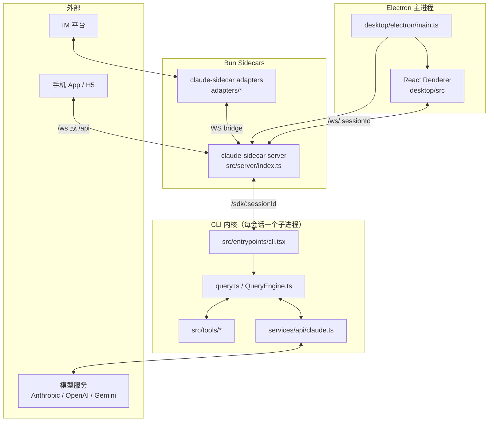

### A.2 CLI 启动时序

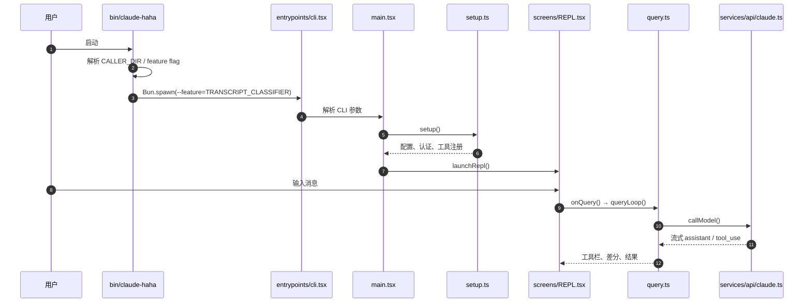

### A.3 单轮 Agent 主循环

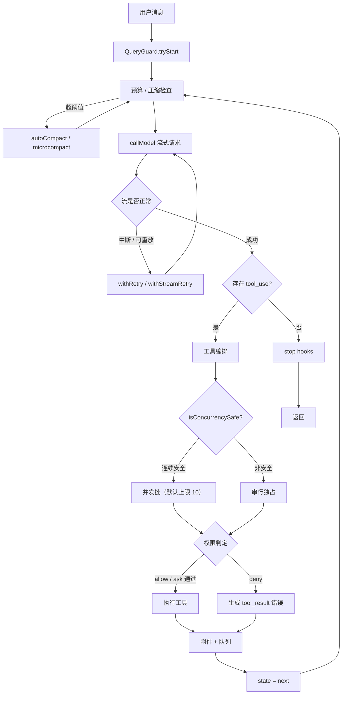

### A.4 一次工具调用的权限时序

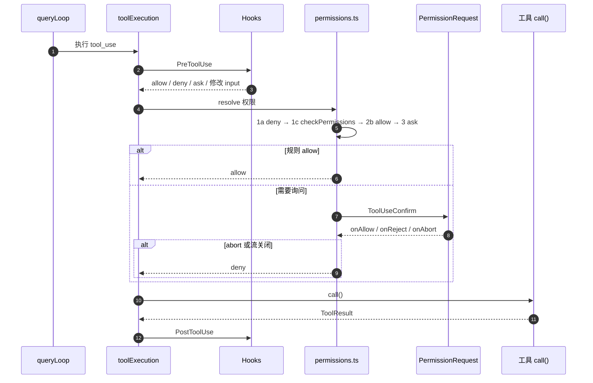

### A.5 自动压缩决策

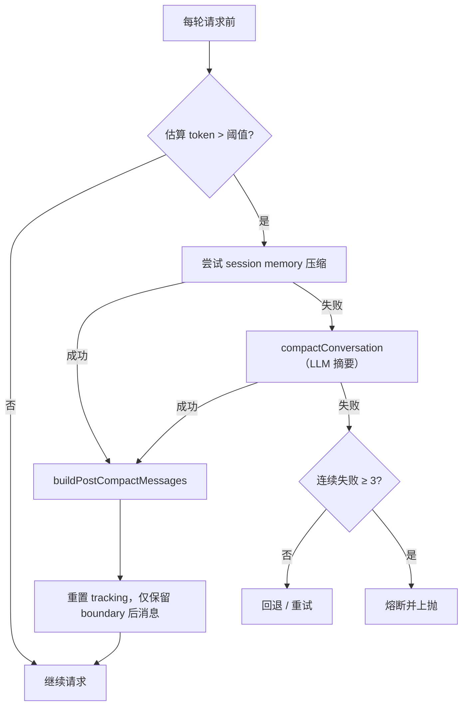

### A.6 Server ↔ CLI 桥接时序

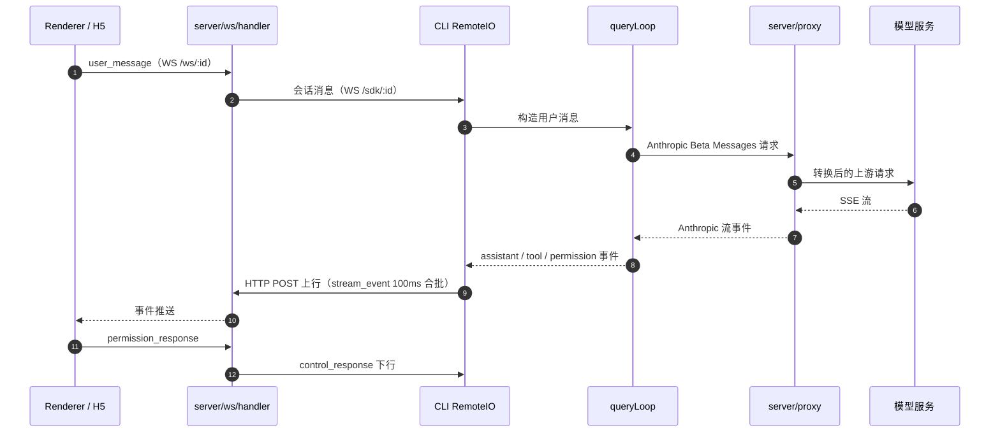

说明：CLI 侧 `HybridTransport` 的语义是**读走 WebSocket、写走 HTTP POST**；不要把它理解成纯 WS 双向。

### A.7 子 Agent spawn 时序

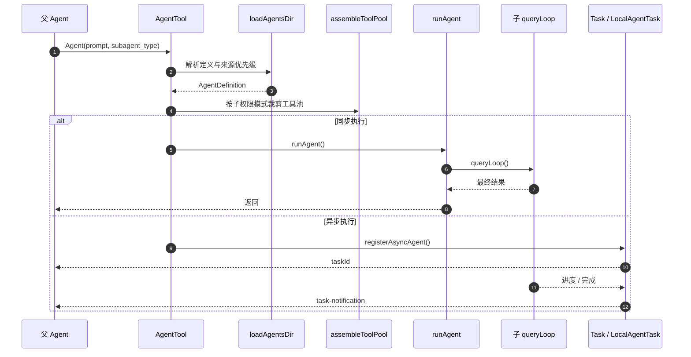

### A.8 模块分层与依赖方向

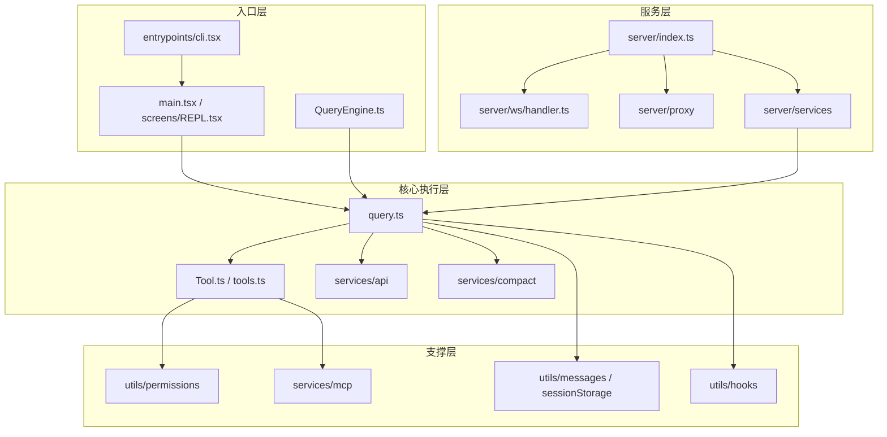

### A.9 类继承与协议实现关系

传输层（这是内核里少见的真实 OOP 继承）：

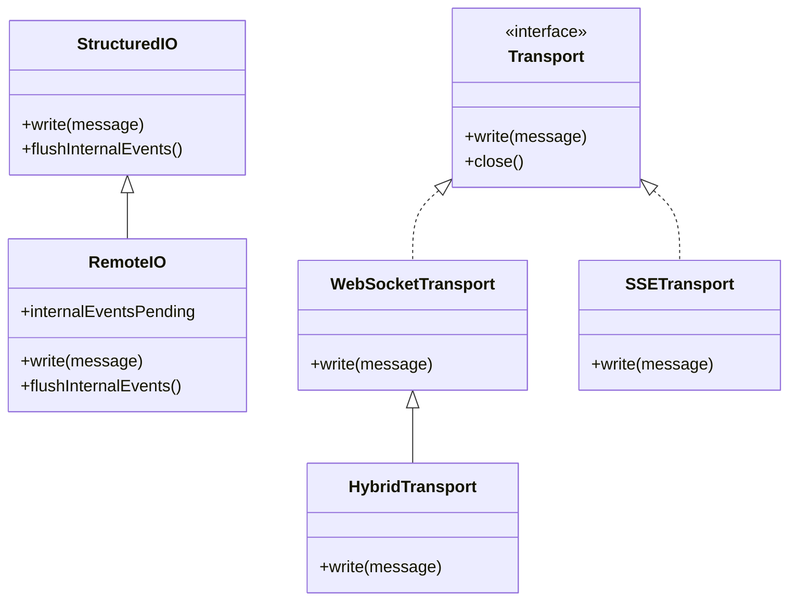

> 注意：`src/cli/transports/Transport.ts` 在此构建中是自动生成的 stub；`Transport` 只作为类型使用，运行时被擦除。

Ink 事件层：

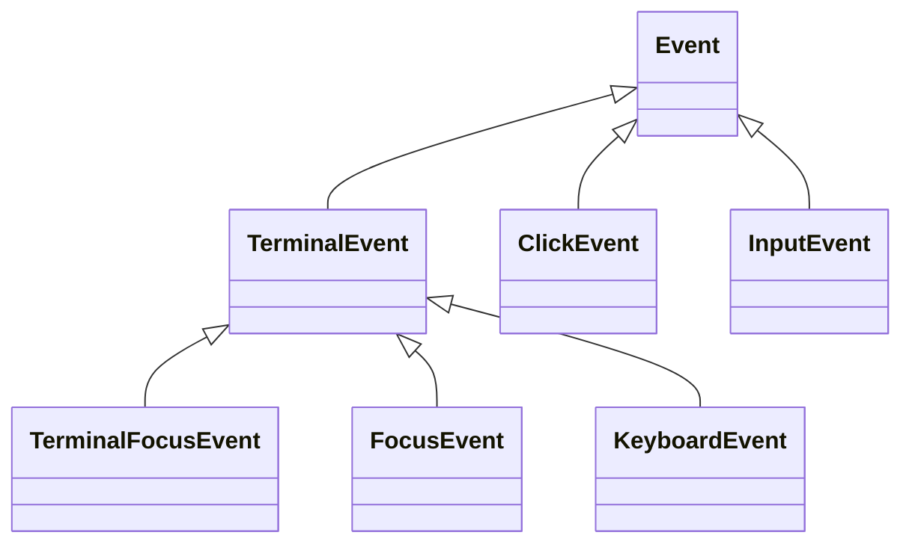

工具层不是类继承，而是**结构化类型 + 工厂默认值**：

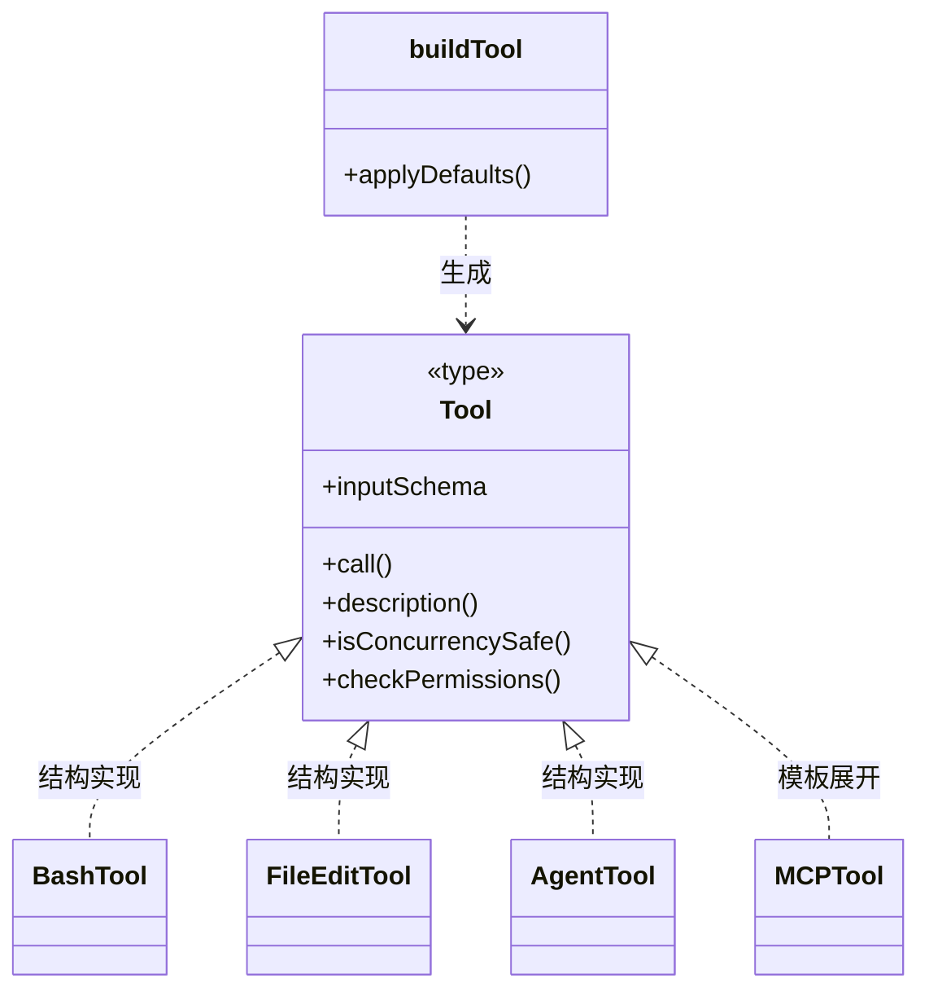

`buildTool` 的默认值正是风险来源：`isConcurrencySafe` / `isReadOnly` 默认 `false`（失败安全），但 `checkPermissions` 默认 `allow`（失败开放）。

### A.10 后台任务状态机

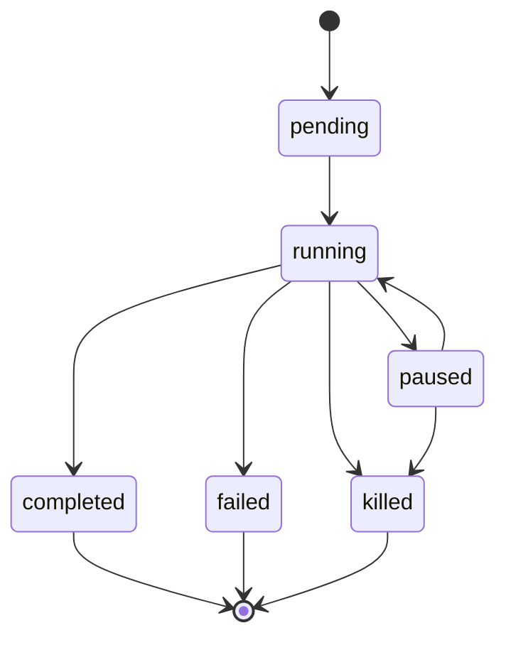

只有 `terminal + notified` 的任务可以被 GC（`utils/task/framework.ts:48-143,184-295`）。

### A.11 Agent Teams 消息流

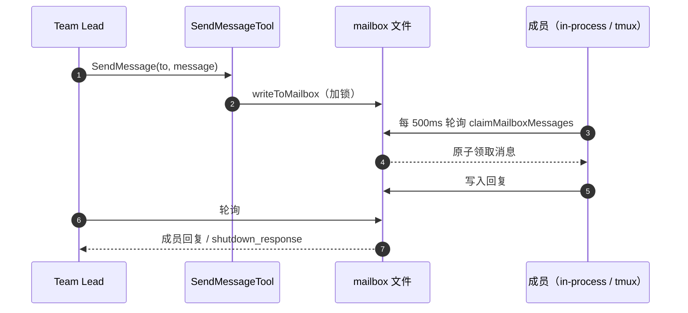

风险点：sender 只是一个 `from` 字符串，没有认证；任何能写 `~/.claude/teams` 的本地进程都能伪造消息或成员。

---

## 附录 B：多 Agent 协作的具体实现

### B.1 三种形态

| 形态 | 生命周期 | 通信方式 | 典型入口 |
|---|---|---|---|
| 子 Agent（subagent） | 一次任务，可后台 | 返回值 / `SendMessage` 追加消息 | `Agent({ subagent_type })` |
| Agent Teams | 常驻，跨多轮 | 文件 mailbox + 500ms 轮询 | `TeamCreate` + `Agent({ team_name, name })` |
| Workflow | 一次编排运行 | `agent()` / `parallel()` / `pipeline()` | `WorkflowTool` |

三者共用同一个 Agent 循环：`runAgent()` 内部调用 `query()`。区别只在**谁负责创建、谁负责给下一轮输入、结果怎么回去**。

### B.2 子 Agent 的 spawn

`AgentTool` 的输入（`src/tools/AgentTool/AgentTool.tsx:91-106`）：

```ts
subagent_type?: string
run_in_background?: boolean
name?: string          // 可被 SendMessage 寻址
team_name?: string     // 有值且同时给 name → 走 Teams spawn
isolation?: 'worktree' | 'remote'
cwd?: string
model?: string
```

执行顺序：

1. **解析定义**：`loadAgentsDir` 扫描 `~/.claude/agents`、项目 `.claude/agents`、插件、内置、CLI `--agents`、托管策略；同名按 `built-in < plugin < user < project < flag < policy` 选最高优先级（`loadAgentsDir.ts:212-246`）。
2. **裁剪工具池**：用子 Agent 自己的 `permissionMode` 重新 `assembleToolPool`，不复用父池（`AgentTool.tsx:610-615`）；`agentToolUtils.ts:72-118` 过滤掉 Agent/编辑类等禁用工具。fork 模式例外，用 `useExactTools` 复用父池以保 prompt cache（`:656-679`）。
3. **解析模型/effort**：`getAgentModel` → `SUBAGENT_MODEL` / `inherit` / 同层别名；effort 缺省继承父会话（`runAgent.ts:637-653`）。
4. **上下文**：
   - 普通子 Agent 只收到新的 user message（`runAgent.ts:574-576`）。
   - fork 子 Agent 继承父 messages + 父 system prompt，并把未完成的 tool call 过滤掉（`:516-548`）。
5. **执行**：同步走 `runAgent()`；异步走 `registerAsyncAgent()` + `runAsyncAgentLifecycle()`，注册成 `local_agent` 任务，前台任务超过 120 秒自动转后台（`LocalAgentTask.tsx:590-681`）。
6. **结果回传**：同步直接返回；异步通过 `<task-notification>` XML 通知，先去重（原子置 `notified`）再入队（`LocalAgentTask.tsx:234-302`）。
7. **worktree 隔离**：创建临时 worktree，无改动则删、有改动保留并把路径写进 metadata 供 resume（`AgentTool.tsx:634-740`；`worktree.ts:1084-1148`）。

### B.3 Teams 的存储与身份

`TeamCreate` 在 `~/.claude/teams/<team>/config.json` 写入（`teamHelpers.ts:78-115`）：

```json
{
  "name": "feature-team",
  "leadAgentId": "...",
  "leadSessionId": "...",
  "reviewRequired": false,
  "members": [
    {
      "agentId": "...",
      "name": "frontend-dev",
      "agentType": "general-purpose",
      "model": "sonnet",
      "tmuxPaneId": "%3",
      "cwd": "/repo",
      "subscriptions": [],
      "backendType": "tmux",
      "joinedAt": 1760000000000
    }
  ]
}
```

关键约束（都是代码里写死的）：

- **roster 是扁平数组**。teammate 不能再 spawn teammate（`AgentTool.tsx:277-281`），否则成员没有 provenance。
- **in-process teammate 不能 spawn 后台 Agent**（`:282-287`），因为生命周期绑在 leader 进程上。
- 团队还有一份共享任务目录 `~/.claude/tasks/<team>/`，成员可以领取任务。
- `TeamCreate` 支持传 `plan`：先存成 draft，等人工在桌面端 review 通过才真正启动成员（`teamPlanStore.ts`、`teamPlanPolicy.ts`）。

### B.4 消息协议：邮箱文件

每个成员一个 inbox（`teammateMailbox.ts:87-132`）：

```text
~/.claude/teams/<team>/inboxes/<agent>.json          # 只存未读
~/.claude/teams/<team>/inboxes/<agent>.history.jsonl # 追加式历史
```

消息结构：

```ts
type TeammateMessage = {
  id: string
  from: string        // 只是一个名字字符串，没有签名
  text: string
  timestamp: string
  read: boolean
  color?: string
  summary?: string
}
```

写入 `writeToMailbox`（`:454-492`）：

1. `ensureInboxDir`。
2. 文件不存在则以 `wx` 创建空数组。
3. `updateInbox` 在 `proper-lockfile` 锁内追加。
4. 锁参数：30 次重试、5–100ms 退避，总预算约 2.6 秒（`:69-82`）。
5. 锁竞争失败返回 `false`，**消息会丢**——调用方只记录日志，没有重试队列。

读取用 `claimMailboxMessages`（`:504-541`）：

- 先读未读，再在锁内按 `id/from/timestamp` 身份匹配，把命中的置为 `read`，返回本次真正领取到的子集。
- 两个消费者并发读同一个 inbox，不会同时领到同一条消息。
- 读取后把已读条目移入 `.history.jsonl`，live inbox 只保留未读。

`SendMessage` 的路由（`SendMessageTool.ts`）：

| `to` | 行为 |
|---|---|
| 成员名 | `writeToMailbox` |
| `*` | 遍历 `team.members` 逐个写（不是原子广播） |
| 普通子 Agent | `queuePendingMessage` 到 `LocalAgentTask` |
| 结构化消息 | `shutdown_request` / `shutdown_response` / `plan_approval_response` |

### B.5 in-process 执行循环

`runInProcessTeammate`（`inProcessRunner.ts:1257`）是一个常驻循环：

```text
初始化身份、context、transcript
  ↓
currentPrompt = 初始 prompt（包成 <teammate-message>）
  ↓
while (!shouldExit)
  ├─ runAgent({ promptMessages: currentPrompt, forkContextMessages: allMessages, ... })
  │    └─ 内部就是 query()，与普通子 Agent 完全同一条循环
  ├─ 收集本轮消息，更新 task 状态/进度
  ├─ waitForNextPromptOrShutdown()   ← 轮询
  └─ 根据 WaitResult 生成下一轮 currentPrompt
```

`waitForNextPromptOrShutdown`（`:1051-1166`）每 **500ms** 轮询，优先级固定：

1. **UI 注入的 pending user message**（`task.pendingUserMessages`）——最高优先。
2. **mailbox**：shutdown 请求单独优先返回，保证不会被其他消息饿死（`:987-1006`）。
3. **团队任务列表**：`claimNextInProcessTask` 领取未认领任务（`:1145-1155`）。
4. deadline / cancel 信号。

投递规则（`takeTeammateMailbox:978-1037`）：

- 一次把当前所有可投递消息**合并成一个 prompt**，每条各自包一层 `<teammate-message from="...">`。
- 协议帧（shutdown/plan approval 等）不会变成自然语言给模型，只有 lead 发来的 plan approval 例外。
- 投递前先 claim；claim 失败则这一轮不投递，下一轮再试。

**崩溃窗口**：claim 是“先标记已读再返回”，如果进程在 claim 之后、消息真正进入模型之前崩溃，这条消息不会重投。这是 at-most-once 语义。

### B.6 后端切换

`registry.ts:351-389` + `detectAndGetBackend:136-254`：

```text
-p / 非交互          → in-process（强制）
终端里已有 tmux      → 在当前窗口 split pane
iTerm2 + it2 可用    → iTerm2 pane
其他                 → in-process
spawn 失败           → 回退 in-process
```

- **in-process**：同进程，`AsyncLocalStorage` 隔离上下文，共享 API client / MCP 连接；用 `AbortController` 终止。
- **tmux / iTerm2**：独立进程，通过 CLI flag 继承 permission / model / effort / env；用 pane id 管理生命周期。
- 两条路径都使用**同一套文件 mailbox**，所以跨后端可以混用。

### B.7 权限协作

- **in-process teammate**：通过模块级 bridge 使用 leader REPL 的 `ToolUseConfirm` 队列（`leaderPermissionBridge.ts:1-50`）。`createInProcessCanUseTool`（`inProcessRunner.ts:188-240`）先跑通用权限判定，Bash 再尝试分类器自动放行，仍未决才弹 leader 的权限框。
- **tmux teammate**：权限请求经 `permissionSync` / `useSwarmPermissionPoller` 同步给 lead，由 lead 的 UI 处理。
- 因此 in-process 成员可以弹窗，真正的后台子 Agent 不能——这是代码注释里明确写出的差异（`inProcessRunner.ts:1604-1606`）。

### B.8 关停

```text
Lead: SendMessage({ to: "frontend-dev", message: { type: "shutdown_request" }})
  → 成员模型看到请求，自行决定
  → SendMessage({ type: "shutdown_response", approve: true/false })
  → Lead 收到 approval 后从 roster 摘除
  → TeamDelete（仍有非 lead 成员会拒绝）
```

in-process 成员 approval 后走 `abort`；pane 成员走 `gracefulShutdown` 再关 pane。

### B.9 Workflow 是另一条路径

Workflow 不走 mailbox：

- 模型生成一段 JS，运行时是 `node:vm` 沙箱（无原型、禁 `codeGeneration`、禁 import、`Date.now`/`Math.random` 抛错）。
- 提供 host 函数 `agent()` / `parallel()` / `pipeline()`，子 Agent 固定 `acceptEdits`。
- 用 journal 记录每个 step 的 started/result，支持断点续跑；第一个 cache miss 后全部重跑。
- 资源上限：1000 agents、4096 fanout、30s sync timeout、token budget 硬闸。

### B.10 实现上的局限

1. **没有认证**：`from` 是自报字符串；能写 `~/.claude/teams` 的本地进程可以伪造任意成员消息或关机批准（`attachments.ts:3871-3923`）。
2. **文件轮询延迟**：成员空闲时最坏 500ms 才能收到消息；广播是 N 次独立写入，不是原子操作。
3. **锁竞争会丢消息**：`writeToMailbox` 超过 2.6 秒仍拿不到锁就返回 `false`，调用方不重试。
4. **投递 at-most-once**：claim 后崩溃会丢消息。
5. **in-process 共享事件循环**：一个成员的长同步任务会阻塞同进程的其他成员；pane 后端没有这个问题。
6. **扁平 roster**：不支持嵌套团队；`TeamFile.members` 没有 parent 关系，硬性禁止 teammate 再 spawn teammate。
7. **状态分散**：团队状态在 `config.json`、inbox、history、task list、transcript 五处，任何一处损坏都可能导致成员“失联”。
