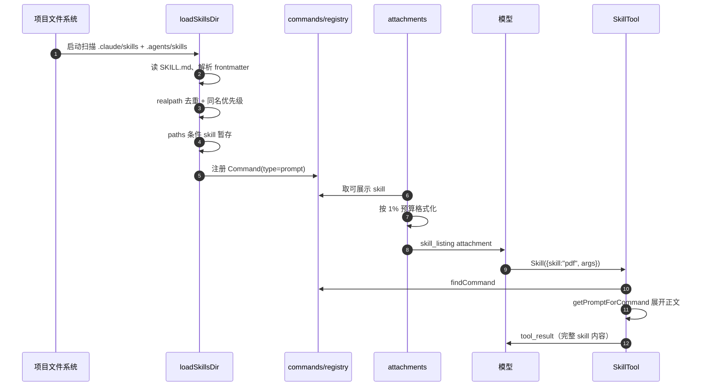

# 普通项目的 Skills 是如何被加载的

> 代码基线：`main` @ `569bf22`
> 以 `<repo>/.claude/skills/pdf/SKILL.md` 为例子，梳理从磁盘到模型上下文的完整链路。
> 核心结论：**启动时扫描并去重 → 只注入“名字 + 一句话描述”（1% 预算）→ 模型调用时才展开正文。**

---

## 0. 全链路总览



---

## 1. 发现：从哪些目录找

入口：`src/skills/skillRoots.ts` + `src/skills/loadSkillsDir.ts:722`

每个作用域都会同时看 `.claude/skills` 和跨客户端的 `.agents/skills`：

| 作用域 | 路径 | 说明 |
|---|---|---|
| managed | `<managed>/.claude/skills` | 组织策略 |
| user | `~/.claude/skills`、`~/.agents/skills` | 用户级 |
| project | 从 cwd 向上到 home 的每一级：`<dir>/.claude/skills`、`<dir>/.agents/skills` | 只收存在的目录 |
| add-dir | `<dir>/.claude/skills`、`<dir>/.agents/skills` | `--add-dir` |
| legacy | `<dir>/.claude/commands` | 旧式命令，也可当 skill |

关键点：

- 项目级不是只看 cwd，而是 `walkProjectDirsUpToHome(cwd)`，越靠近 cwd 越优先（`skillRoots.ts:132-153`）。
- `.agents` 默认开启，可用 `disableAgentSkillsDirectory` 或 `CLAUDE_CODE_DISABLE_AGENT_SKILLS_DIR` 关闭。
- 整个结果按 cwd `memoize`；文件变化时通过 `skillChangeDetector` 清缓存。

---

## 2. 读取：只认目录格式

`loadSkillsFromSkillsDir()`（`loadSkillsDir.ts:424-507`）：

```text
<skills-dir>/
  └── pdf/
      └── SKILL.md
```

规则：

- `/skills/` **只支持 `<name>/SKILL.md`**，单文件 `.md` 会被跳过（legacy `/commands/` 才支持单文件）。
- 符号链接会被跟随读取。
- 目录名就是 skill 名；`isRenderableSkillName` 拒绝含控制字符的名字，防止它往 listing 里写额外行。
- 读不到 `SKILL.md` 的目录直接跳过。

---

## 3. 解析 frontmatter

`parseSkillFrontmatterFields()`（`loadSkillsDir.ts:202-282`）支持的字段：

| 字段 | 作用 |
|---|---|
| `name` | 显示名 |
| `description` | 列表里的描述；缺失时从正文首行提取 |
| `when_to_use` | 追加到描述，帮助模型匹配 |
| `allowed-tools` | 该 skill 运行时允许的工具 |
| `argument-hint` / `arguments` | 参数提示与命名参数 |
| `model` / `effort` | 覆盖模型与推理强度 |
| `disable-model-invocation` | 禁止模型主动调用 |
| `user-invocable` | 是否出现在 `/` 菜单 |
| `hooks` | skill 专属 hooks |
| `context: fork` | 在子 Agent 里执行 |
| `agent` | fork 时使用哪个 Agent |
| `shell` | inline shell 使用的 shell |
| `paths` | 条件激活的路径模式 |

然后 `createSkillCommand()`（`:287-418`）把它转成一个 `Command`：

```ts
{
  type: 'prompt',
  name: 'pdf',
  description,
  whenToUse,
  allowedTools,
  model,
  effort,
  context,
  agent,
  paths,
  source: 'projectSettings',
  loadedFrom: 'skills',
  skillRoot: '/repo/.claude/skills/pdf',
  contentLength,
  isHidden: !userInvocable,
  getPromptForCommand(...)
}
```

**正文此时不会进入上下文**，只记录 `contentLength`。

### 调用时才展开正文

`getPromptForCommand()`：

1. 前面加 `Base directory for this skill: ...`
2. 替换 `$ARGUMENTS` / 命名参数
3. 替换 `${CLAUDE_SKILL_DIR}`、`${CLAUDE_SESSION_ID}`
4. 执行 inline shell（`` !`...` ``），但 **MCP skill 不执行**，因为远端内容不可信

---

## 4. 去重与优先级

`loadSkillsDir.ts:851-898`：

1. **先按 realpath 文件身份去重**：同一个文件通过符号链接或多个根目录出现，只保留一份。
2. **再按名字冲突处理**：
   - `.claude` 永远压过 `.agents`（`outranksClaimedSkill`）；
   - 同 flavor 按根顺序：managed → user → project（最近优先）→ add-dir；
   - legacy `/commands/` 不抢占别人，只在名字空着时填充；
   - 被覆盖的会打 warn 日志。

---

## 5. 条件 skill 先不加载

`loadSkillsDir.ts:910-935`：

带 `paths:` 的 skill 不会进入初始列表，而是放进 `conditionalSkills` map。

当会话中读/写/编辑了某个文件时：

```ts
activateConditionalSkillsForPaths(filePaths, cwd)
```

用 `ignore` 库（gitignore 风格）匹配相对路径，命中后移进 `dynamicSkills`，并触发 `skillsLoaded` 事件。

---

## 6. 会话中的动态发现

`discoverSkillDirsForPaths()`（`:1000-1060`）：

- 从被操作文件的父目录开始，向上走到 cwd（**不含 cwd**，因为 cwd 级启动时已加载）；
- 检查每一级的 `.claude/skills` 和 `.agents/skills`；
- 用 `git check-ignore` 跳过 gitignored 目录，防止 `node_modules/pkg/.claude/skills` 被加载；
- 检查结果（命中或未命中）都缓存，避免每次 Read 都 stat；
- 按路径深度排序，越靠近文件的 skill 优先级越高。

命中后 `addSkillDirectories()` 加载并写入 `dynamicSkills`。

---

## 7. 注入模型：`skill_listing` attachment

`getSkillListingAttachments()`（`src/utils/attachments.ts:2830-2919`）：

1. 如果当前工具池里没有 `Skill` 工具 → 不注入。
2. 取本地 skills + MCP skills，按 name 去重。
3. 每个 `agentId` 维护一个 `sentSkillNames`，**只发增量**；子 Agent 有自己的一份。
4. `--resume` 时 `suppressNext` 为真，直接标记全部已发送，避免重复注入。
5. 用 `formatCommandsWithinBudget()` 格式化。

### 预算规则

`SkillTool/prompt.ts:20-41`：

```ts
SKILL_BUDGET_CONTEXT_PERCENT = 0.01   // 上下文窗口的 1%
CHARS_PER_TOKEN = 4
DEFAULT_CHAR_BUDGET = 8000
MAX_LISTING_DESC_CHARS = 250          // 单条描述上限
```

- 总预算 = 上下文 token × 4 × 1%；
- 每条格式：`- name: description - whenToUse`；
- 单条描述超过 250 字符截断；
- 超预算时：**bundled skill 永不截断**，先截断其他 skill 的描述；极端情况只保留 `- name`。

### 过滤条件

`getSlashCommandToolSkills()`（`src/commands.ts:622-644`）：

```ts
cmd.type === 'prompt' &&
cmd.source !== 'builtin' &&
(cmd.hasUserSpecifiedDescription || cmd.whenToUse) &&
(cmd.loadedFrom === 'skills' ||
 cmd.loadedFrom === 'plugin' ||
 cmd.loadedFrom === 'bundled' ||
 cmd.disableModelInvocation)
```

`getSkillToolCommands()` 另外排除 `disableModelInvocation` 的 skill。

所以普通项目的 skill 要出现在列表里，需要：

- frontmatter 有 `description`，或者正文第一行能提取出描述；
- 没有被 `disable-model-invocation` 禁用；
- 没有被同名更高优先级的 skill 覆盖；
- 不是尚未激活的条件 skill。

注入后由 `src/utils/messages.ts:4020` 包成 system-reminder 交给模型。

---

## 8. 模型真正调用时

`SkillTool.call()`（`src/tools/SkillTool/SkillTool.ts:591-667`）：

1. 去掉名字前的 `/`；
2. `findCommand` 在运行时注册表里查找——**即使 skill 没出现在 listing 里，只要加载过就能调用**；
3. 记录使用情况；
4. 如果 `context === 'fork'` → `executeForkedSkill()`，在子 Agent 中执行；
5. 否则 `processPromptSlashCommand()` → `getPromptForCommand()`：
   - 展开参数和变量；
   - 执行 inline shell；
   - 把完整正文作为 prompt 返回。

结果是：**列表阶段只有一句话；调用阶段才把整份 `SKILL.md` 正文注入对话**。这是 skill 相对“把全部说明塞进系统提示”的核心优势。

---

## 9. 几个容易踩的点

1. **普通 `/skills/` 不支持单 `.md` 文件**，必须是 `<name>/SKILL.md`。
2. **目录名即 skill 名**，控制字符会被拒绝。
3. `.agents/skills` 默认参与加载，可能带来其他工具安装的同名 skill。
4. **条件 skill 未命中路径时不会出现在列表里**，但 `paths` 匹配是 gitignore 风格。
5. **gitignored 目录里的 skill 不会被动态发现**。
6. **列表预算只有 1%**，skill 多时描述会被截断，甚至只剩名字。
7. **compact 后不会重新注入 listing**，但 skill 仍在运行时注册表里，模型仍可调用。
8. **MCP skill 不执行 inline shell**，这是明确的安全边界。

---

## 10. 最小示例

目录：

```text
my-repo/
└── .claude/
    └── skills/
        └── pdf/
            └── SKILL.md
```

`SKILL.md`：

```markdown
---
name: pdf
description: Extract text and tables from PDF files
when_to_use: When the user asks to parse or summarize a PDF
allowed-tools: Read, Bash
---

# PDF Processing

Use `pdftotext` to extract text...

Run: !`which pdftotext`
```

加载结果：

```text
skill name:   pdf
description:  Extract text and tables from PDF files
whenToUse:    When the user asks to parse or summarize a PDF
loadedFrom:   skills
source:       projectSettings
```

模型看到的 listing 大致是：

```text
- pdf: Extract text and tables from PDF files - When the user asks to parse or summarize a PDF
```

模型调用 `Skill({ skill: "pdf" })` 后，正文、`${CLAUDE_SKILL_DIR}` 展开、inline shell 输出才会进入上下文。

---

## 11. 关键代码索引

| 功能 | 位置 |
|---|---|
| 作用域根目录 | `src/skills/skillRoots.ts:132-176` |
| 读取 `SKILL.md` | `src/skills/loadSkillsDir.ts:424-507` |
| frontmatter 解析 | `src/skills/loadSkillsDir.ts:202-282` |
| 生成 Command | `src/skills/loadSkillsDir.ts:287-418` |
| 去重与优先级 | `src/skills/loadSkillsDir.ts:851-898` |
| 条件 skill 分离 | `src/skills/loadSkillsDir.ts:910-935` |
| 动态发现 | `src/skills/loadSkillsDir.ts:1000-1060` |
| 条件激活 | `src/skills/loadSkillsDir.ts:1137-1200` |
| listing 注入 | `src/utils/attachments.ts:2830-2919` |
| 预算与格式化 | `src/tools/SkillTool/prompt.ts:20-171` |
| 可展示过滤 | `src/commands.ts:622-644` |
| Skill 调用 | `src/tools/SkillTool/SkillTool.ts:591-667` |
