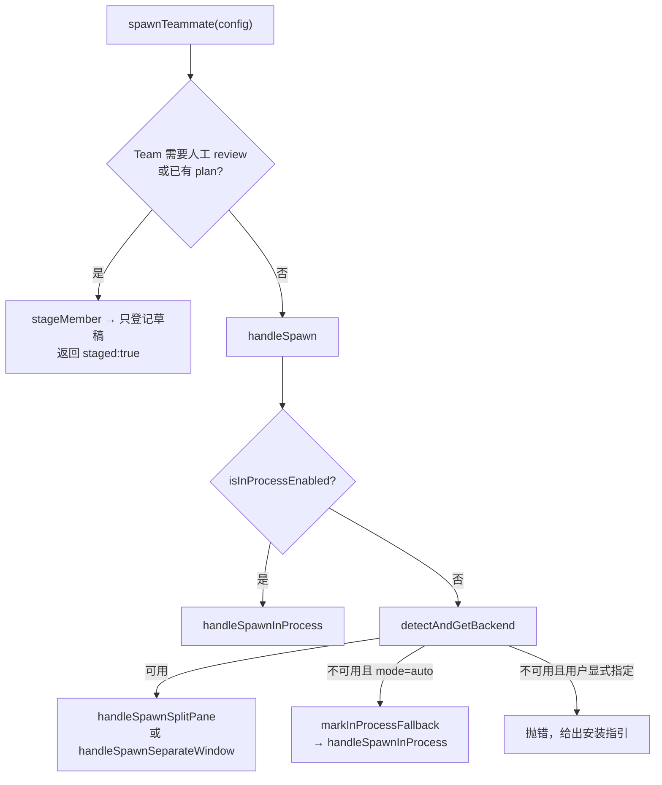

# `spawnTeammate` 是什么

> 代码基线：`main` @ `569bf22`
> 位置：`src/tools/shared/spawnMultiAgent.ts:1135`
> 上游调用：`AgentTool.call()` 中 `team_name && name` 分支
> 结论：它是 **Agent Teams 成员的统一创建入口**，不是 Agent 执行器本身。

---

## 0. 一句话

`spawnTeammate` 负责“把成员登记进团队，并决定用什么后端把它跑起来”：

- 登记成员（团队文件 `config.json`）；
- 分配唯一名字、ID、颜色；
- 选择后端：in-process / tmux / iTerm2；
- in-process 直接启动常驻循环，pane 后端启动独立 CLI 进程；
- 返回成员身份和 pane 信息。

真正的 Agent 循环不在这里，而在：

```text
in-process → startInProcessTeammate → runInProcessTeammate → runAgent → query()
pane       → 独立 claude 进程 → 自己的 Agent 循环
```

---

## 1. 函数签名

```ts
export async function spawnTeammate(
  config: SpawnTeammateConfig,
  context: ToolUseContext,
): Promise<{ data: SpawnOutput }>
```

### 输入

```ts
type SpawnTeammateConfig = {
  name: string                 // 成员名，必须唯一
  prompt: string               // 初始任务
  team_name?: string           // 不传则从当前 teamContext 继承
  cwd?: string
  use_splitpane?: boolean      // true=分屏，false=独立窗口
  plan_mode_required?: boolean
  model?: string
  agent_type?: string          // general-purpose / 自定义 Agent
  description?: string
  invokingRequestId?: string   // 用于链路追踪
}
```

### 输出

```ts
type SpawnOutput = {
  staged?: boolean             // 仅 draft 阶段
  plan_id?: string
  revision?: number
  message?: string
  teammate_id: string
  agent_id: string
  agent_type?: string
  model?: string
  name: string
  color?: string
  tmux_session_name: string
  tmux_window_name: string
  tmux_pane_id: string
  team_name?: string
  is_splitpane?: boolean
  plan_mode_required?: boolean
}
```

---

## 2. 两条主路径



---

## 3. 路径 1：人工 review 门禁（1137-1187）

如果团队启用了 `reviewRequired`，或者已经存在 `plan.json`：

1. 必须有团队，否则抛错；
2. 只有团队创建者所在的 session 能提交成员；
3. 对当前 Agent 目录做快照（`snapshotTeamAgents`）；
4. 解析 provider / model / effort；
5. 调用 `stageMember()`，只把成员写进 **draft**，**不启动**。

返回：

```ts
{
  staged: true,
  plan_id: "...",
  revision: 1,
  message:
    "Member recorded in the team draft, NOT started. " +
    "Complete all members and tasks, then submit the whole plan with TeamPlan. " +
    "Only human confirmation starts execution.",
  teammate_id: "",
  agent_id: "",
  ...
}
```

这就是桌面端 TeamPlan 的人工审批流程：模型可以“提案”成员，但必须由人确认才开始执行。

---

## 4. 路径 2：直接 spawn（1087-1125）

`handleSpawn` 的决策顺序：

1. **`isInProcessEnabled()` 为真** → 直接 in-process。
2. **否则先探测 pane 后端** `detectAndGetBackend()`：
   - 探测失败，且当前模式是 `auto` → `markInProcessFallback()`，走 in-process；
   - 探测失败，且用户显式配置了 `teammateMode: 'tmux'` → 抛错，展示安装指引。
3. **探测成功**：
   - `use_splitpane !== false` → `handleSpawnSplitPane`
   - 否则 → `handleSpawnSeparateWindow`

后端类型：

```ts
type BackendType = 'tmux' | 'iterm2' | 'in-process' | 'process'
```

---

## 5. in-process 后端（873-1079）

### 5.1 解析参数

```ts
const leaderModel = context.options.mainLoopModel ?? appState.mainLoopModel
const selectedAgentDefinition = activeAgents.find(a => a.agentType === agent_type)
const model = resolveTeammateModel(
  input.model,
  leaderModel,
  getAgentModelSetting(selectedAgentDefinition, leaderModel),
  selectedAgentDefinition !== undefined,
)
```

### 5.2 在团队文件锁内登记成员

```ts
await mutateTeamFileAsync(teamName, (teamFile) => {
  sanitizedName = pickUniqueTeammateName(baseName, teamFile.members)
  teammateId = formatAgentId(sanitizedName, teamName)
  teammateColor = assignTeammateColor(teammateId)
  teamFile.members.push({
    agentId: teammateId,
    name: sanitizedName,
    agentType: agent_type,
    model,
    prompt,
    color: teammateColor,
    planModeRequired: plan_mode_required,
    joinedAt: Date.now(),
    tmuxPaneId: 'in-process',
    cwd: getCwd(),
    subscriptions: [],
    backendType: 'in-process',
  })
})
```

锁内完成三件事：

- 名字唯一（并发 spawn 不会撞名）；
- 确定性 ID `name@team`；
- 颜色分配。

### 5.3 创建并启动

```ts
const result = await spawnInProcessTeammate(config, context)

if (!result.success) {
  // 释放刚占用的名字
  await removeMemberByAgentId(teamName, teammateId)
  throw new Error(result.error ?? 'Failed to spawn in-process teammate')
}

startInProcessTeammate({
  identity: { agentId: teammateId, agentName: sanitizedName, teamName, ... },
  taskId: result.taskId,
  prompt,
  description: input.description,
  model,
  agentDefinition,
  teammateContext: result.teammateContext,
  toolUseContext: { ...context, messages: [] },
  abortController: result.abortController,
  invokingRequestId: input.invokingRequestId,
})
```

注意 `toolUseContext: { ...context, messages: [] }`：不把父会话消息传给成员，成员自己通过 `allMessages` 维护历史，避免把父对话钉在内存里。

`startInProcessTeammate` 是 **fire-and-forget**，不会 await 整个 Agent 生命周期。

### 5.4 更新 AppState

把成员写进 `teamContext.teammates`，必要时自动注册 leader：

```ts
setAppState(prev => ({
  ...prev,
  teamContext: {
    ...prev.teamContext,
    teamName,
    leadAgentId,
    teammates: {
      ...existingTeammates,
      ...leadEntry,
      [teammateId]: {
        name: sanitizedName,
        agentType: agent_type,
        color: teammateColor,
        tmuxSessionName: 'in-process',
        tmuxPaneId: 'in-process',
        cwd: getCwd(),
        spawnedAt: Date.now(),
      },
    },
  },
}))
```

### 5.5 不走 mailbox

代码注释明确：

> Do NOT send the prompt via mailbox for in-process teammates. In-process teammates receive the prompt directly via `startInProcessTeammate()`. The mailbox is only needed for tmux-based teammates which poll for their initial message. Sending via both paths would cause duplicate welcome messages.

### 5.6 返回

```ts
{
  teammate_id, agent_id, agent_type, model, name, color,
  tmux_session_name: 'in-process',
  tmux_window_name: 'in-process',
  tmux_pane_id: 'in-process',
  team_name,
  is_splitpane: false,
  plan_mode_required,
}
```

---

## 6. pane 后端（tmux / iTerm2）

顺序：

1. 创建 pane（分屏或独立窗口）。
2. 在 pane 里执行 `claude` 命令，带上 team、权限模式、模型等参数。
3. 注册后台任务（`registerOutOfProcessTeammateTask`），让成员出现在任务面板。
4. 在团队文件锁内把成员 push 进 `config.json`。
5. **通过 mailbox 发送初始 prompt**——pane 成员靠 inbox 轮询拿到第一条消息。
6. 返回真实的 `tmux_session_name / window_name / pane_id`。

关键代码：

```ts
await mutateTeamFileAsync(teamName, (teamFile) => {
  teamFile.members.push({
    agentId: teammateId,
    name: sanitizedName,
    agentType: agent_type,
    model,
    prompt,
    color: teammateColor,
    planModeRequired: plan_mode_required,
    joinedAt: Date.now(),
    tmuxPaneId: paneId,
    cwd: workingDir,
    subscriptions: [],
    backendType: detectionResult.backend.type,
  })
})

await writeToMailbox(
  sanitizedName,
  {
    from: TEAM_LEAD_NAME,
    text: prompt,
    timestamp: new Date().toISOString(),
  },
  teamName,
)
```

---

## 7. 与 `runAgent` 的区别

| | `spawnTeammate` | `runAgent` |
|---|---|---|
| 职责 | 登记成员、选后端、启动成员 | 执行一次 Agent 循环 |
| in-process | 调 `startInProcessTeammate`（fire-and-forget） | 直接跑 `query()` |
| pane | 启动独立 CLI 进程 | 不涉及 |
| 返回值 | `SpawnOutput`（成员身份、pane 信息） | `AsyncGenerator<Message>` |
| 是否等待完成 | 否，立即返回 | 是，迭代到 `done` |

`AgentTool.call()` 中：

```ts
if (teamName && name) {
  const result = await spawnTeammate({ ... })
  return { status: 'teammate_spawned' | 'teammate_staged', ... }
}
```

走这条路后，`call()` **不再调用 `runAgent`**；真正执行由成员自己的进程或 in-process 循环负责。

---

## 8. 失败与回滚

| 场景 | 行为 |
|---|---|
| in-process spawn 失败 | `removeMemberByAgentId` 释放名字，然后抛错 |
| pane 后端不可用 + auto | 静默回退 in-process，并标记 `inProcessFallbackActive` |
| pane 后端不可用 + 显式 tmux | 抛错，展示 tmux 安装指引 |
| 团队不存在 | `assertAgentTeamExists` 抛错 |
| review 模式下非 owner | 拒绝 |

---

## 9. 总结

`spawnTeammate` 是一个**编排层**，不是执行层：

```text
spawnTeammate
  ├─ review gate → stageMember（只写 draft）
  └─ handleSpawn
       ├─ in-process → spawnInProcessTeammate → startInProcessTeammate
       └─ pane → 创建 pane → 启动 claude → 写 mailbox
```

它解决的问题是：

- 成员身份与唯一性；
- 团队文件的一致性；
- 后端选择与降级；
- 审批门禁；
- 不同后端的启动差异。

Agent 真正的推理和工具调用，发生在它启动出来的执行器里。
