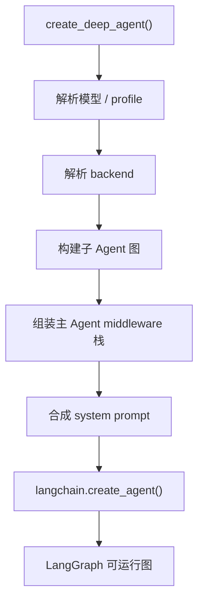

# LangChain Deep Agents 内部实现分析

> 分析对象：`langchain-ai/deepagents`（Python 核心包）
> 源码基线：2026-10-30 提交（`main`）
> 说明：`deepagent` 不在 cc-haha 仓库中；本文分析的是 LangChain 的 Deep Agents。

---

## 0. 定位：三层中的最上层

```text
Deep Agents      opinionated harness：默认中间件、backend、profile
LangChain        agent 抽象：model + tools + middleware → agent loop
LangGraph        运行时：state、checkpoint、streaming、interrupt、恢复
```

官方 `libs/ARCHITECTURE.md` 明确说明：Deep Agents **不引入新运行时**，而是把长任务 Agent 需要的能力打包好，再交给 `langchain.agents.create_agent()`。

---

## 1. `create_deep_agent()` 的组装流程

入口：`libs/deepagents/deepagents/graph.py:289`

```text
1. 解析模型 + provider/harness profile
2. 解析 backend（文件、memory、shell 存在哪）
3. 组装主 Agent 的 middleware 栈
4. 构建默认 general-purpose 子 Agent + 调用方子 Agent
5. 合成 system prompt
6. create_agent(...) 生成 LangGraph 图
7. .with_config(...) 附加元数据和 recursion_limit
```

### 组装示意



---

## 2. 主 Agent 的中间件栈

来自 `graph.py:907-988`，顺序很关键：

| 顺序 | 中间件 | 作用 |
|---|---|---|
| 1 | `FilesystemMiddleware` | 挂载文件工具 + `execute`，执行路径权限 |
| 2 | `SubAgentMiddleware` | 注入 `task` 工具 |
| 3 | `ParentNotifierMiddleware` | 向父图发通知 |
| 4 | `SummarizationMiddleware` | 上下文超限时摘要/卸载 |
| 5 | `PatchToolCallsMiddleware` | 修补悬空 tool call |
| 6 | `AsyncSubAgentMiddleware`（可选） | 远程 LangSmith 子 Agent |
| 7 | profile 额外中间件 | 供应商/模型适配 |
| 8 | `SkillsMiddleware`（可选） | 技能注入 |
| 9 | prompt caching | 打缓存断点 |
| 10 | `MemoryMiddleware`（可选） | 记忆注入 |
| 11 | `HumanInTheLoopMiddleware`（可选） | 人工审批 |
| 12 | `UnsupportedContentMiddleware` | 清理不支持的内容 |
| 13 | `_ToolExclusionMiddleware` | 最后剔除 profile 禁用的工具 |

顺序设计：

- memory 放在 caching 之后，避免记忆更新破坏 Anthropic 的 prompt cache 前缀；
- 工具剔除放最后，防止自定义中间件把工具加回来；
- 用户中间件插在 core 之后、tail 之前。

---

## 3. 子 Agent 的实现

### 3.1 定义方式

`middleware/subagents.py`

```python
class SubAgent(TypedDict):
    name: str
    description: str
    model: ...
    tools: ...
    middleware: ...
    mode: "isolated" | "fork"   # 默认 isolated
```

也支持 `CompiledSubAgent`：调用方直接传一个已构建好的 runnable。

### 3.2 编译：每个子 Agent 是一张独立图

`create_sub_agent()`（`subagents.py:575`）：

```python
create_agent(
    model,
    system_prompt=spec["system_prompt"],
    tools=spec["tools"],
    middleware=middleware,
    name=spec["name"],
)
```

也就是说，子 Agent 不是函数调用，而是**独立的 LangGraph 图**。

### 3.3 子 Agent 的中间件栈

`graph.py:736-796`：

```text
FilesystemMiddleware
SummarizationMiddleware
PatchToolCallsMiddleware
[profile extras]
[SkillsMiddleware]
prompt caching
[MemoryMiddleware（仅 fork）]
[HumanInTheLoop]
[ToolExclusion]
```

### 3.4 `task` 工具如何调用

`_build_task_tool()`（`subagents.py:647`）生成：

```python
task(description, subagent_type, runtime)
```

执行顺序：

1. 递归检查：fork 子 Agent 禁止再 delegation；
2. 校验 `subagent_type` 存在；
3. 选择对应 runnable；
4. 准备 state；
5. `subagent.invoke(state, config)` / `ainvoke`；
6. 把结果包成：

```python
Command(update={"messages": [ToolMessage(...)]})
```

返回给父图。

**同步阻塞**：父 Agent 调 `task` 后等子图跑完才继续；并行需要模型在一条消息里发多个 `task` tool call。

### 3.5 两种上下文模式

| 模式 | 子 Agent 看到什么 |
|---|---|
| `isolated`（默认） | 只收到 `HumanMessage(description)`，加上父 state 里非私有的字段 |
| `fork` | 继承父消息历史、父 system prompt、父中间件栈，只加一段 fork 指令 |

fork 路径用 `_fork_messages()` 复制父对话；`_FORKED_CONTEXT_KEY` 会阻止子 Agent 再调 `task`。

### 3.6 与 cc-haha 的根本差别

Deep Agents 的子 Agent：同进程、同 LangGraph 运行时、通过 state 和 `Command` 通信。

cc-haha 的子 Agent：`runAgent` 循环；Teams 成员甚至是独立进程 + 文件 mailbox。

---

## 4. Backend：文件、记忆、Shell 存在哪

核心协议：`backends/protocol.py:404` `BackendProtocol`

```python
ls, read, write, edit, delete, glob, grep
```

沙箱后端额外实现 `execute`（`SandboxBackendProtocol:892`）。

| Backend | 存储位置 |
|---|---|
| `StateBackend` | 当前 thread 的图状态里（默认） |
| `StoreBackend` | 跨 thread 的 LangGraph Store |
| `FilesystemBackend` | 本地磁盘 |
| `CompositeBackend` | 按路径前缀路由，例如 `/memories/` 走持久 store |
| `LocalShellBackend` | 本地文件 + shell |
| `ContextHubBackend` | 带写意图队列的持久后端 |
| `LangSmithSandbox` | LangSmith 沙箱 |

如果 backend 不支持 shell，`execute` 工具和 shell 提示词会在组装时被移除。

---

## 5. 状态与持久化

- `DeepAgentState` 继承 LangChain 的 `AgentState`；
- `messages` 使用 **`DeltaChannel` + delta reducer**（`_messages_reducer.py`），checkpoint 增长保持线性；
- reducer 负责：按 ID 去重、`RemoveMessage` 墓碑、`REMOVE_ALL_MESSAGES` 重置；
- LangGraph 负责 checkpoint、resume、interrupt；
- 中间件可以通过 `state_schema` 贡献自己的字段；标记为 private 的字段不会传给子 Agent。

---

## 6. 上下文管理

`middleware/summarization.py:34-35` 默认值：

```python
trigger=("fraction", 0.85)   # 上下文用到 85% 触发
keep=("fraction", 0.10)      # 保留最近 10%
```

非 Anthropic 模型回退：

```python
trigger=("tokens", 170000)
keep=("messages", 6)
```

机制：

1. 触发后调用模型生成摘要；
2. 被淘汰的历史**卸载到 backend**，摘要里保留文件路径；
3. 图片/视频等 base64 媒体先卸载，避免撑爆摘要请求；
4. `truncate_args_settings` 在摘要前截断旧 tool call 的参数；
5. `PatchToolCallsMiddleware` 修复压缩产生的悬空 tool call。

---

## 7. 权限

两层：

- **文件权限**：`FilesystemMiddleware` 对内置文件工具做 glob 规则匹配，first-match-wins；这是强制执行，不是“隐藏工具”。
- **人工审批**：`HumanInTheLoopMiddleware` 按 `interrupt_on` 在工具调用前中断图，等待人工 approve。

权限与工具可见性分离：模型仍可能看到一个稍后会被拒绝的工具。

---

## 8. 工具面

最终模型看到的工具 = 中间件注入 + 调用方 `tools=` + backend 能力：

```text
ls, read_file, write_file, edit_file, delete, glob, grep   # 文件
execute                                                    # 仅 shell backend
task                                                       # 子 Agent
```

profile 可以用 `excluded_tools` 再裁剪。

---

## 9. 和 cc-haha 的对照

| 维度 | Deep Agents | cc-haha |
|---|---|---|
| 运行时 | LangGraph 图 | 自研 `queryLoop` 生成器 |
| Agent 组装 | middleware 栈 + `create_agent` | Tool 对象 + `runAgent` 参数 |
| 子 Agent | 嵌套图，同进程，`task` 工具 | `AgentTool.call` → `runAgent`；Teams 走进程/mailbox |
| 子 Agent 通信 | 图 state + `Command` + `ToolMessage` | 返回值 / `<task-notification>` / mailbox |
| 文件抽象 | `BackendProtocol` 可插拔 | 直接文件工具 + 路径权限 + sandbox |
| 上下文压缩 | 中间件 + 卸载到 backend | autoCompact / microcompact |
| 权限 | FS glob + HITL interrupt | permission modes + hooks + classifier |
| 持久化 | LangGraph checkpoint | JSONL transcript + SQLite 索引 |

一句话：**Deep Agents 是“基于 LangGraph 的中间件式 Agent harness”，cc-haha 是“基于自研循环和多进程的 Claude Code 重构”**。两者都在解决长任务、子 Agent、上下文压缩、文件抽象，但组合方式完全不同。

---

## 10. 继续阅读的入口

```text
libs/ARCHITECTURE.md
libs/deepagents/deepagents/graph.py:289                    create_deep_agent()
libs/deepagents/deepagents/middleware/subagents.py:647     task 工具
libs/deepagents/deepagents/backends/protocol.py:404        BackendProtocol
libs/deepagents/deepagents/middleware/summarization.py:34  默认阈值
libs/deepagents/deepagents/middleware/filesystem.py:1608   文件工具名
```

---

## Sources

- [Deep Agents Architecture (GitHub)](https://github.com/langchain-ai/deepagents/blob/afff4f88/libs/ARCHITECTURE.md?plain=1)
- [Doubling down on Deep Agents (LangChain)](https://www.langchain.com/blog/doubling-down-on-deepagents)
- [Deep Agents overview (docs)](https://docs.langchain.com/oss/python/deepagents/overview.md)
